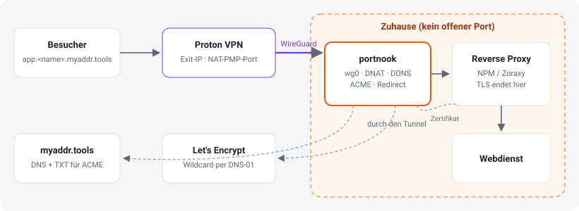
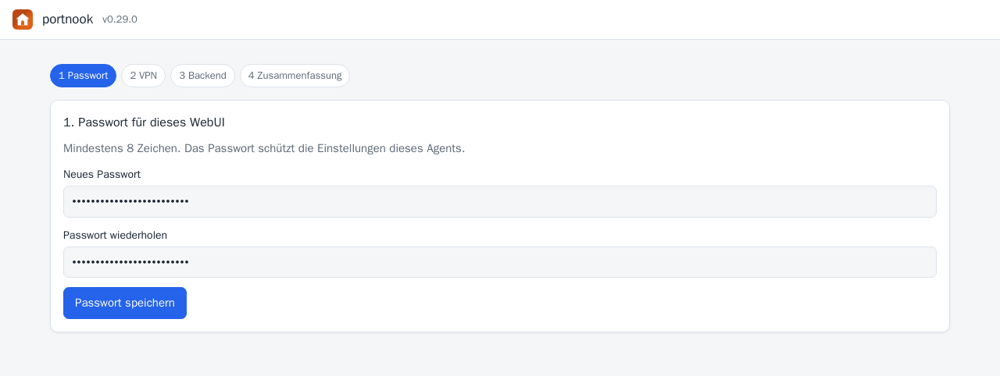
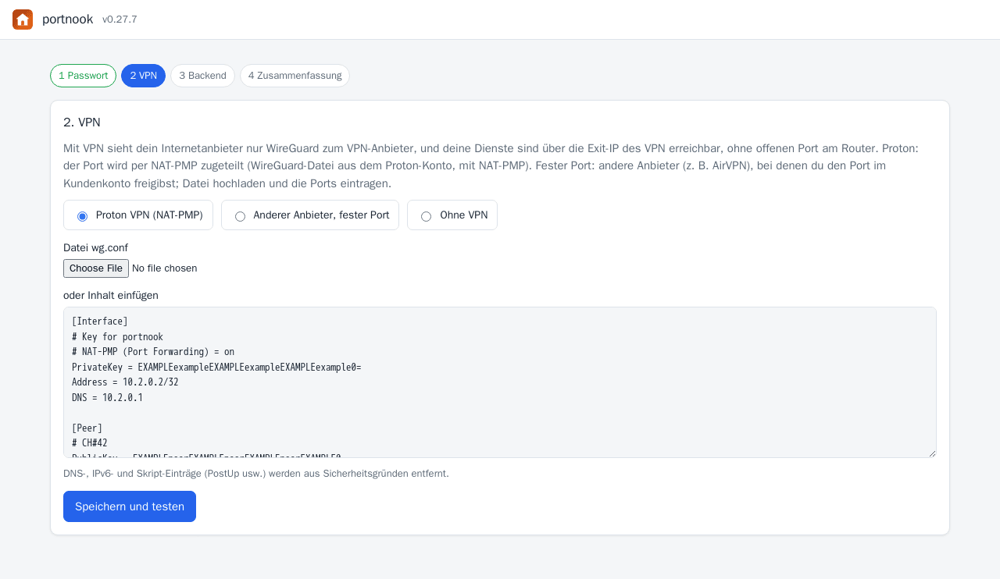
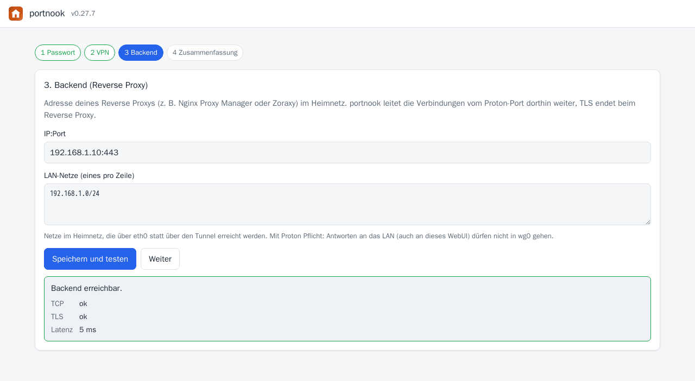
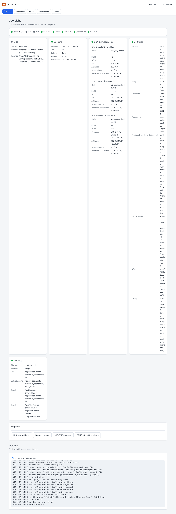
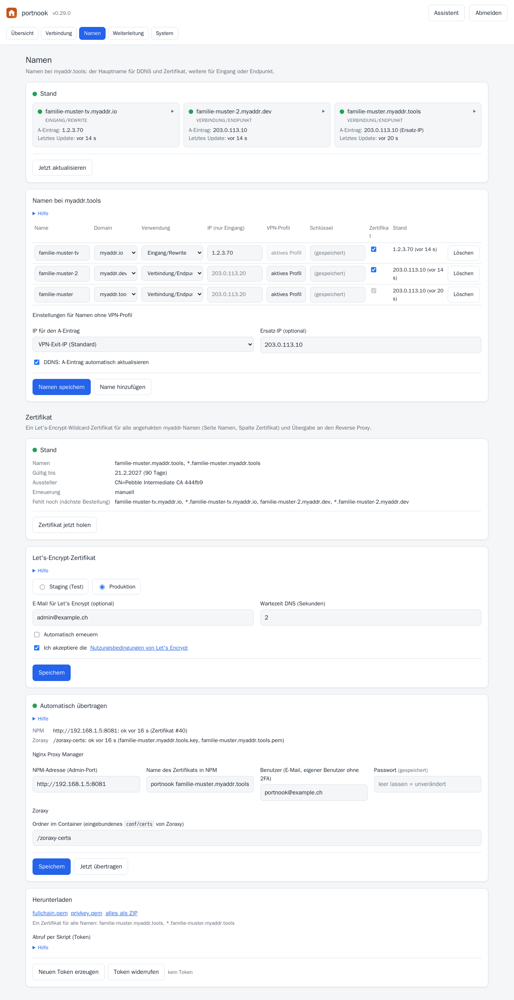
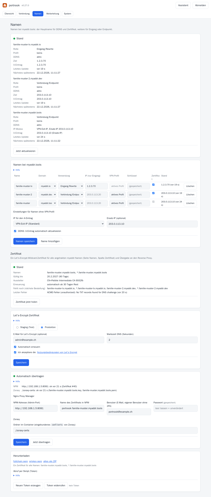
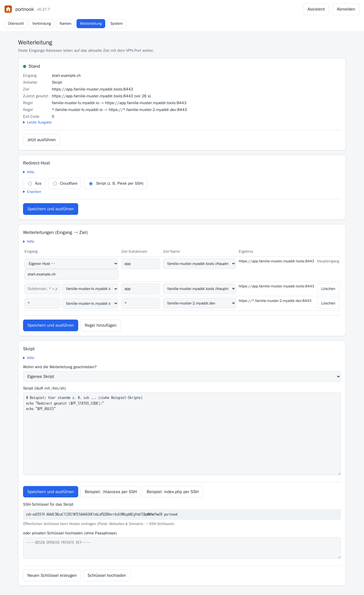
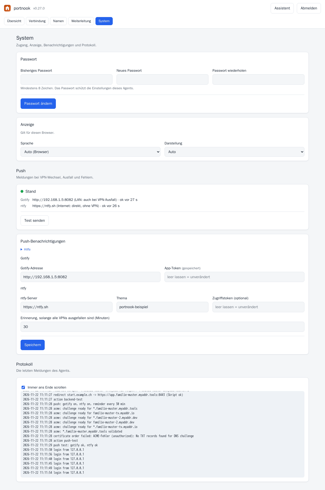
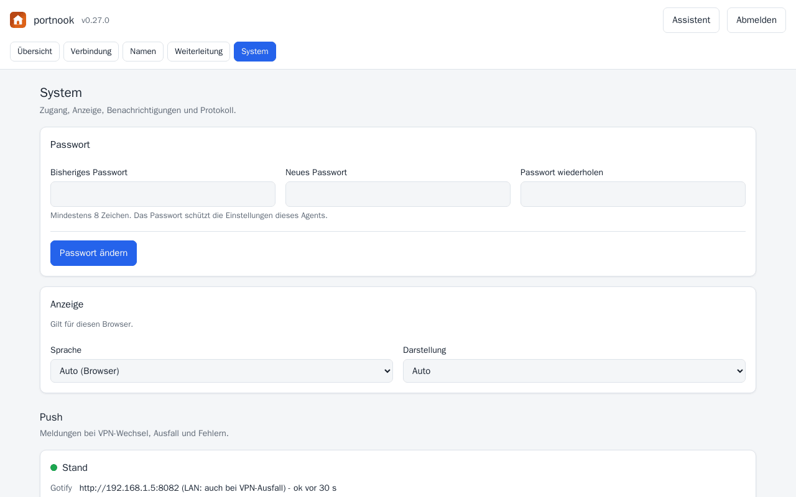

<p align="center"></p>

<p align="center"><b>Your web services reachable from anywhere, with no open port at home, your own name and a
valid certificate.</b></p>

<p align="center"><a href="README.md">Deutsch</a> · <b>English</b> · <a href="https://github.com/ghostgw-nook/portnook/wiki">Wiki</a></p>

<p align="center"></p>

**portnook** is a Docker container for your home network. It builds the WireGuard tunnel to Proton VPN, gets a
port on the Proton exit IP via NAT-PMP and forwards it to your reverse proxy. It also keeps a free name at
[myaddr.tools](https://myaddr.tools) on the exit IP, gets a Let's Encrypt wildcard certificate for that name and
hands it to Nginx Proxy Manager or Zoraxy. Everything is set up in the browser.

The step-by-step guides (how it works, setup, Zoraxy, Nginx Proxy Manager, port 443 or a dedicated port) are in
the **[Wiki](https://github.com/ghostgw-nook/portnook/wiki)**. The detailed installation guide
[docs/installation.md](docs/installation.md) is in German.

## Why

- **No open port on the router:** The tunnel is built from home. Your ISP only sees WireGuard to Proton, visitors
  only see the Proton IP.
- **Your own name instead of IP and port:** `https://app.family-example.myaddr.tools:<port>`, the name follows
  the exit IP automatically.
- **A real certificate without manual work:** wildcard for all subnames, renewed automatically, delivered
  straight to the reverse proxy.
- **TLS ends at home:** The reverse proxy stays yours; portnook only forwards and delivers the certificate.

## Features

### Wizard in three steps

Password, VPN (upload and test the WireGuard file, or "Without VPN"), backend (IP:port of the reverse proxy).
After that the port is up.

| Password | VPN | Backend |
|---|---|---|
|  |  |  |

### Status at a glance

VPN, NAT-PMP, backend, DDNS, certificate, delivery and redirect in green, yellow or red, with details and the log
below. Buttons to reconnect the VPN, renew NAT-PMP, test the backend and update DDNS.



### Name and certificate

- **DDNS via myaddr.tools:** A record on the VPN exit IP, on every change and at least every 30 days (otherwise
  myaddr deletes the record). If the exit IP is unknown, an optional fallback IP is sent, otherwise nothing; or a
  fixed manual IP. **The IP of your internet connection is never sent to myaddr.tools.**
- **No tunnel, no internet (since 0.10.1):** Without a tunnel portnook contacts no service on the internet –
  neither myaddr.tools (not even with a fallback or manual IP) nor Let's Encrypt, Cloudflare or the redirect
  script. Updates are queued (latest state only) and sent through the tunnel once it is back. Only LAN targets
  (private addresses: NPM, Zoraxy folder) and the push servers, which are always reached directly (see below),
  stay reachable. Without any VPN portnook therefore works in the LAN only (no DDNS, no certificate).
- **Several VPN profiles with failover and standby tunnel:** next to the active VPN a second profile runs all
  the time as standby, with its own port, exit IP and, if you like, its own myaddr name. If the active one fails,
  the standby takes over at once, with no rebuild. Without a DNS wait this needs a second DNS name: if the
  standby has its own myaddr name, the redirect points to it right away. If both profiles share one name, it has
  to be updated first, and clients may need a few minutes to see the new IP (DNS cache). The
  list order is a fixed priority. A name can follow several profiles (the active one, else the standby). If all
  of them fail, nothing but push messages goes over your home line.
- **Other VPN providers:** besides Proton (NAT-PMP), any provider's WireGuard file with fixed ports opened in your
  account (e.g. AirVPN); you enter the ports in the UI. The key is entered once and never shown again.
- **Let's Encrypt via DNS-01:** certificate for `<name>.myaddr.tools` and `*.<name>.myaddr.tools`; test with
  staging first, then production. Renewal at 30 days left.
- **Delivery:** download (`fullchain.pem`, `privkey.pem`, ZIP), pull by token and script
  ([`docs/pull-cert.sh`](docs/pull-cert.sh)), automatic upload to **Nginx Proxy Manager** (the same certificate is
  replaced on renewal) and a copy into the certificate folder of **Zoraxy**.

| myaddr | Certificate |
|---|---|
|  |  |

### Redirect host

The Proton port changes now and then. A fixed address such as `https://start.example.com` therefore answers with a
302 to the current target and is updated on every port change: through a **Cloudflare** rule or your own
**script** (example: `.htaccess` via SSH on a Plesk web hosting). More rules redirect further entry hosts, also
`*.entry` to `*.<name>.myaddr.tools` (subdomain to subdomain). All myaddr names are listed on the **Names** page;
the "Use" column sets what each one is for (entry or endpoint). The certificate covers all names with a key.

> Note: some apps remember the redirect target. After a port change, enter the entry address there
> again.



### Push notifications

Through **Gotify** (address + app token) and/or **ntfy** (server + topic, optional token), with a "Send test"
button: VPN profile switch, all VPNs down (with a reminder, every 30 minutes by default), recovery, errors in
DDNS, certificate, redirect, NPM and Zoraxy, and a renewed certificate. The same message at most once per hour.

> **Good to know:** Push messages always go directly over your home line (`eth0`), past the VPN, to servers in
> the LAN and on the internet (e.g. ntfy.sh) alike. So you get the "all VPNs down" alarm even when no tunnel is
> up. The push server sees the IP of your internet connection; your services stay reachable only through the VPN
> tunnel. A message that fails to send is retried later.



### Direct at home, through the VPN from outside

The **LAN entry** also accepts the current VPN port on portnook's LAN IP. If your home DNS (e.g. Technitium)
points `*.<name>.myaddr.tools` to that IP, devices in the LAN and in your home VPN use the same URL and go
straight to the reverse proxy, without a detour through Proton. The record is static; portnook follows the port.
See the wiki page [Home network and LAN entry](https://github.com/ghostgw-nook/portnook/wiki/Home-network-and-LAN-entry).

### MTU per VPN profile

Each profile has a fixed **MTU** (default 1340, room for double-nested WireGuard; a single VPN needs 1420) or
takes it from the `wg.conf`. The TCP segment size is clamped to match. If videos stall, 1280 often helps.

### Settings: language, light or dark

**System** page, **Display** card: language **Deutsch** (default) or **English**, Auto follows the browser, and
theme (Auto follows the system, or fixed "Light"/"Dark"), both stored per browser. All UI texts live in
`agent/web/lang/de.json` and `en.json`; another language is one more file next to them (missing texts fall back
to `de.json`).



## How it works

```
Visitor ──https://app.<name>.myaddr.tools:<port>──> Proton exit IP:<port>
                                                   │ WireGuard (wg0), built from home
                                            portnook (Docker)
                                                   │ only the NAT-PMP port is forwarded
                                            Reverse proxy (NPM, Zoraxy, …) ─> web service
```

Interfaces, decisions and checked sources (myaddr.tools, NPM, Zoraxy, Cloudflare): [docs/concept.md](docs/concept.md)

## Start in 5 minutes

1. **Requirements:** Docker host at home (Linux ≥ 5.6), reverse proxy in the LAN, Proton VPN with port
   forwarding (NAT-PMP), a name at myaddr.tools (optional).
2. **Start the agent:**

   ```bash
   mkdir portnook && cd portnook
   curl -fsSLO https://raw.githubusercontent.com/ghostgw-nook/portnook/main/agent/docker-compose.yml
   echo "PF_BIND=192.168.1.20" > .env   # LAN IP of the Docker host
   docker compose up -d
   ```

3. **Wizard** at `http://192.168.1.20:8090`, then enter name, key and target on the **Names** page.

Unraid without the Compose plugin: template [`agent/unraid/portnook.xml`](agent/unraid/portnook.xml), see the
wiki page [Installation](https://github.com/ghostgw-nook/portnook/wiki/Installation#unraid).

Updates: `docker compose pull && docker compose up -d`. Backup: the `./data` folder (contains secrets, never
commit it).

## Security

- **No open ports at home:** The web UI only listens on the LAN address chosen with `PF_BIND` (default
  `127.0.0.1`). From Proton only the NAT-PMP port is reachable, and only towards the reverse proxy.
- **Home IP stays hidden:** Requests to myaddr.tools, Let's Encrypt and Cloudflare only go through the tunnel; if
  it is down (or there is no VPN), nothing is sent but queued. A firewall rule (`PF_OUT`) also blocks new
  connections over `eth0` to public addresses. Exception: push messages go out directly on purpose (since
  0.18.0) so the outage alarm arrives; the push service sees the home IP. Requests to NPM and push servers in the
  LAN stay in the LAN.
- **Secrets are write-only:** myaddr keys, NPM password, Cloudflare token, pull token, push tokens and private
  keys are never shown or logged; stored with file mode 600 in `/data`.
- **VPN config cleaned:** `DNS`, IPv6 and script entries such as `PostUp` are removed on upload.

## Status and limits

- Version: see [VERSION](VERSION).
- Tested end to end in CI: wizard, DDNS against a mock myaddr.tools, ACME against **pebble** (Let's Encrypt's
  test CA), delivery to a mock NPM and a Zoraxy folder, pull by token, redirect script, VPN failover with two
  WireGuard peers, the block without a tunnel (no request to the internet, sent later) and push to mock
  Gotify/ntfy servers.
- **Not tested live in CI:** real Let's Encrypt, myaddr.tools, NPM, Zoraxy, Cloudflare API, Proton account and
  Gotify/ntfy. The interfaces are checked against the open source code or the documentation (see
  [docs/concept.md](docs/concept.md)).

## License

Copyright (C) 2026 helmi1987. portnook is free software under the
[GNU Affero General Public License v3.0](LICENSE): you may use, change and share it. Whoever shares a changed
version or runs it as a network service for others must make the source of that version available under the
same license.
