<p align="center"></p>

<p align="center"><b>Deine Webdienste von überall erreichbar, ohne offenen Port zuhause, mit eigenem Namen und
gültigem Zertifikat.</b></p>

<p align="center"><b>Deutsch</b> · <a href="README.en.md">English</a> · <a href="https://github.com/ghostgw-nook/portnook/wiki">Wiki (English)</a></p>

<p align="center">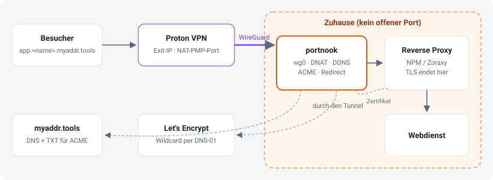</p>

**portnook** ist ein Docker-Container für dein Heimnetz. Er baut den WireGuard-Tunnel zu Proton VPN auf, holt
per NAT-PMP einen Port auf der Proton-Exit-IP und leitet ihn an deinen Reverse Proxy weiter. Dazu hält er einen
kostenlosen Namen bei [myaddr.tools](https://myaddr.tools) auf der Exit-IP, holt ein
Let's-Encrypt-Wildcard-Zertifikat für diesen Namen und übergibt es an Nginx Proxy Manager oder Zoraxy. Alles
wird im Browser eingerichtet.

## Warum

- **Kein offener Port am Router:** Der Tunnel wird von zuhause aus aufgebaut. Dein Internetanbieter sieht nur
  WireGuard zu Proton, die Besucher sehen nur die Proton-IP.
- **Eigener Name statt IP und Port:** `https://app.familie-muster.myaddr.tools:<Port>`, der Name folgt der
  Exit-IP automatisch.
- **Echtes Zertifikat ohne Handarbeit:** Wildcard für alle Unternamen, Erneuerung automatisch, direkt im Reverse
  Proxy.
- **TLS endet zuhause:** Der Reverse Proxy bleibt deiner; portnook leitet nur weiter und liefert das
  Zertifikat.

## Funktionen

### Assistent in drei Schritten

Passwort, Proton (WireGuard-Datei hochladen und testen, oder „Ohne Proton“), Backend (IP:Port des Reverse
Proxys). Danach steht der Port.

| Passwort | Proton | Backend |
|---|---|---|
| 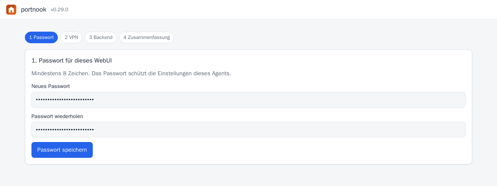 | 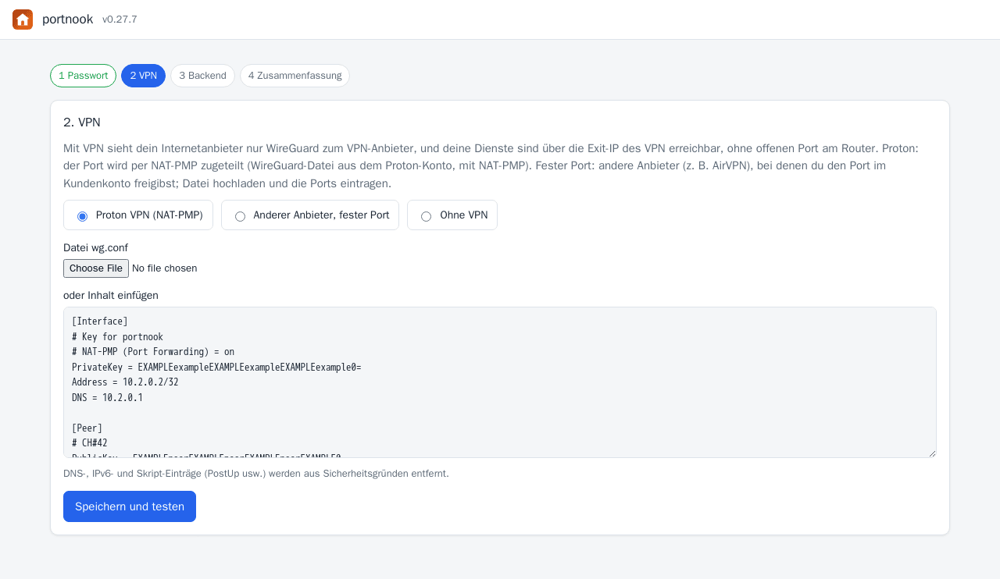 | 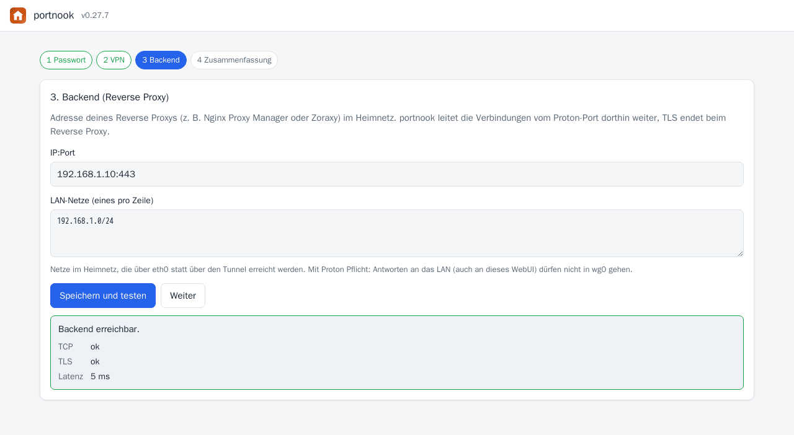 |

### Ampel auf einen Blick

Proton, NAT-PMP, Backend, DDNS, Zertifikat, Übertragung und Redirect mit grün, gelb oder rot, darunter die Details
und das Log. Dazu Knöpfe für Proton neu verbinden, NAT-PMP erneuern, Backend testen und DDNS aktualisieren.

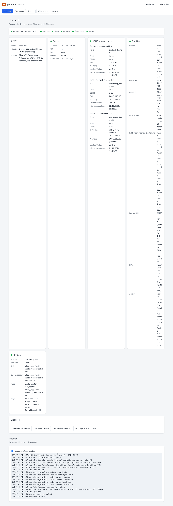

### Name und Zertifikat

- **DDNS über myaddr.tools:** A-Eintrag auf die VPN-Exit-IP, bei jeder Änderung und mindestens alle 30 Tage
  (sonst löscht myaddr den Eintrag). Ist die Exit-IP unbekannt, wird eine optionale Ersatz-IP gemeldet, sonst gar
  nichts; alternativ eine manuell festgelegte IP. **Die IP deines Anschlusses wird nie an myaddr.tools gemeldet.**
- **Ohne VPN-Tunnel kein Internet (seit 0.10.1):** Steht kein Tunnel, kontaktiert portnook keinen Dienst im
  Internet – weder myaddr.tools (auch nicht mit Ersatz- oder manueller IP) noch Let's Encrypt, Cloudflare oder
  das Redirect-Skript. Die Updates werden vorgemerkt (nur der neueste Stand) und durch den Tunnel gesendet, sobald
  er wieder steht. Erreichbar bleiben nur Ziele im LAN (private Adressen: NPM, Zoraxy-Ordner) und die
  Push-Server, die immer direkt gehen (siehe unten). Ganz ohne VPN arbeitet portnook deshalb nur im LAN (kein DDNS,
  kein Zertifikat).
- **Mehrere VPN-Profile mit Failover und Reserve-Tunnel:** neben dem aktiven VPN läuft ein zweites Profil dauernd
  als Reserve, mit eigenem Port, eigener Exit-IP und auf Wunsch eigenem myaddr-Namen. Fällt das aktive aus,
  übernimmt die Reserve sofort, ohne Neuaufbau. Ohne DNS-Wartezeit geht das nur mit einem zweiten DNS-Namen: Hat
  die Reserve ihren eigenen myaddr-Namen, zeigt der Redirect gleich auf ihn. Teilen sich beide Profile einen Namen,
  muss er erst umgestellt werden; bis die Clients die neue IP kennen, kann es einige Minuten dauern (DNS-Cache). Die
  Reihenfolge der Liste ist eine feste Priorität. Ein Name kann auch mehreren Profilen folgen (dem aktiven, sonst
  der Reserve). Sind alle gestört, geht ausser Push-Meldungen nichts über die Heimleitung.
- **Andere VPN-Anbieter:** neben Proton (NAT-PMP) jede WireGuard-Datei eines Anbieters mit festen, im Kundenkonto
  freigegebenen Ports (z. B. AirVPN); die Ports trägst du im UI ein. Der Schlüssel wird einmal eingegeben und nie wieder angezeigt.
- **Let's Encrypt per DNS-01:** Zertifikat für `<name>.myaddr.tools` und `*.<name>.myaddr.tools`, zuerst mit
  Staging testen, dann Produktion. Erneuerung ab 30 Tagen Restlaufzeit.
- **Übergabe:** Download (`fullchain.pem`, `privkey.pem`, ZIP), Abruf per Token und Skript
  ([`docs/pull-cert.sh`](docs/pull-cert.sh)), automatischer Upload an **Nginx Proxy Manager** (gleiches
  Zertifikat wird bei der Erneuerung ersetzt) und Ablage im Zertifikatsordner von **Zoraxy**.
- **Echte Besucher-IP (optional):** Auf Wunsch übergibt portnook die IP des Besuchers per PROXY-Protokoll an den
  Reverse Proxy (Zoraxy mit einem Schalter, Nginx Proxy Manager und nginx über einen eigenen Port). Sonst sieht
  der Reverse Proxy nur die LAN-IP von portnook. Anleitung: [Wiki: Real visitor IP](https://github.com/ghostgw-nook/portnook/wiki/PROXY-protocol).

| myaddr | Zertifikat |
|---|---|
| 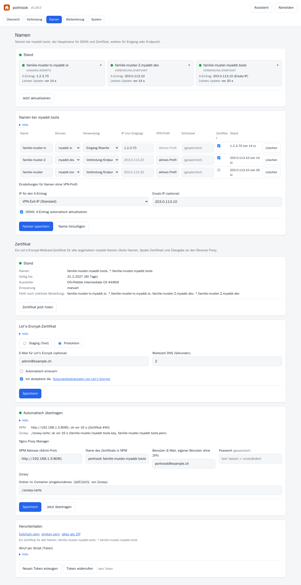 | 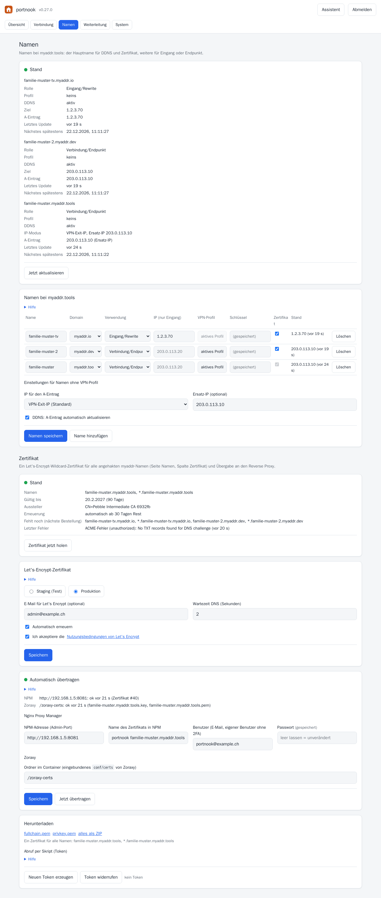 |

### Redirect-Host

Der Proton-Port ändert sich ab und zu. Eine feste Adresse wie `https://start.example.ch` leitet deshalb mit 302 auf
das aktuelle Ziel weiter und wird bei jeder Port-Änderung nachgeführt: über eine **Cloudflare**-Regel oder ein
eigenes **Skript** (Beispiel: `.htaccess` per SSH auf ein Plesk-Webhosting). Weitere Regeln leiten zusätzliche
Eingangs-Hosts weiter, auch `*.eingang` auf `*.<name>.myaddr.tools` (Subdomain auf Subdomain). Alle myaddr-Namen stehen
auf der Seite **Namen** in einer Liste; pro Name legt die Spalte «Verwendung» fest, wofür er da ist (
Eingang oder Endpunkt). Das Zertifikat deckt alle Namen mit Schlüssel ab.

> Hinweis: Manche Apps merken sich das Ziel der Weiterleitung. Nach einer Port-Änderung die
> Eingangs-Adresse dort neu eintragen (eine Lösung dafür ist ein späterer Meilenstein).

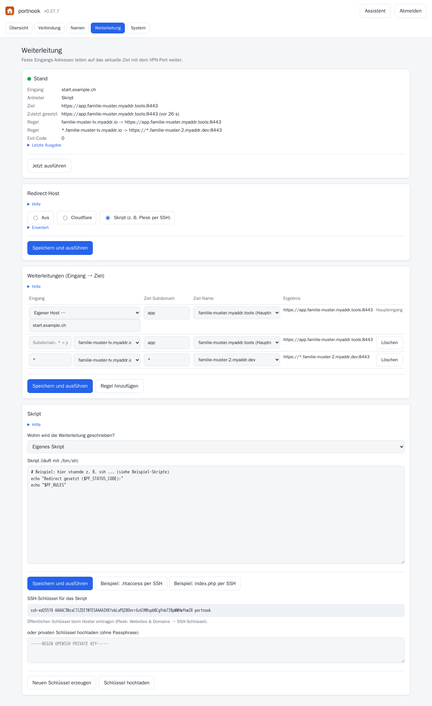

### Push-Benachrichtigungen

Über **Gotify** (Adresse + App-Token) und/oder **ntfy** (Server + Thema, optional Token), mit Knopf „Test senden“:
VPN-Profilwechsel, Ausfall aller VPNs (mit Erinnerung, Standard alle 30 Minuten),
Wiederherstellung, Fehler bei DDNS, Zertifikat, Redirect, NPM und Zoraxy sowie ein erneuertes Zertifikat.
Gleiche Meldungen höchstens einmal pro Stunde.

> **Gut zu wissen:** Push-Meldungen gehen immer direkt über die Heimleitung (`eth0`), am VPN vorbei, an Server im
> LAN genauso wie an Server im Internet (z. B. ntfy.sh). Den Alarm „Alle VPNs ausgefallen“ bekommst du deshalb
> auch dann, wenn kein Tunnel steht. Der Push-Server sieht dabei die IP deines Anschlusses, deine Dienste bleiben
> trotzdem nur über den VPN-Tunnel erreichbar. Klappt das Senden nicht, wird die Meldung später nochmals versucht.

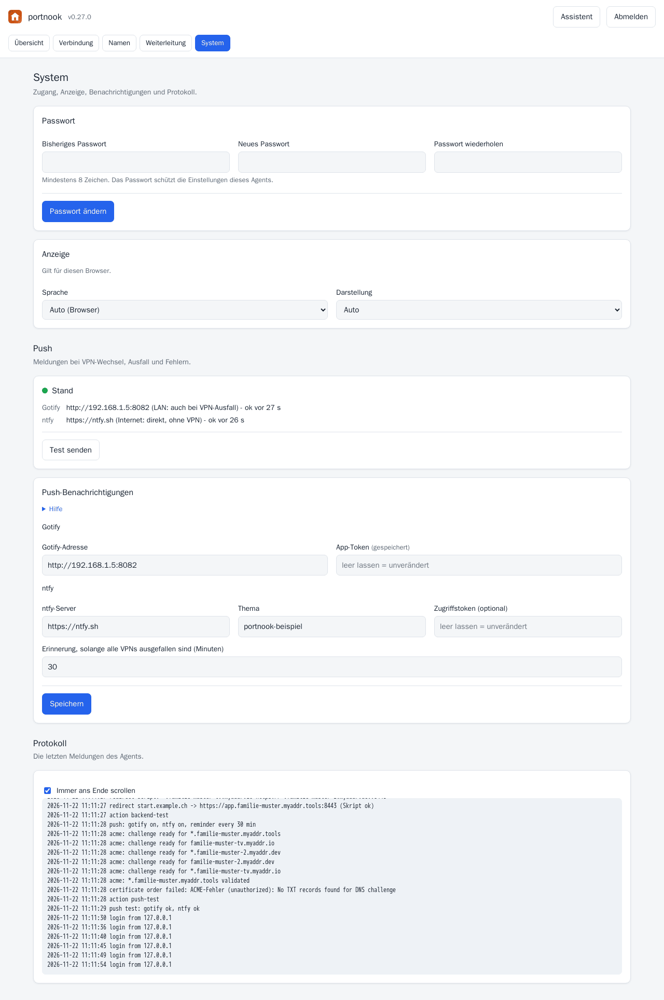

### Intern direkt, extern über VPN

Der **LAN-Eingang** nimmt den aktuellen VPN-Port auch auf der LAN-IP von portnook an. Zeigt dein Heim-DNS
(z. B. Technitium) `*.<name>.myaddr.tools` auf diese IP, gehen Geräte im LAN und im Heim-VPN mit derselben URL
direkt zum Reverse Proxy, ohne Umweg über Proton. Der Eintrag ist statisch, portnook folgt dem Port. Anleitung:
[Intern direkt, extern über VPN](docs/installation.md#intern-direkt-extern-über-vpn).

### MTU pro VPN-Profil

Jedes Profil hat eine feste **MTU** (Standard 1340, Platz für doppelt verschachteltes WireGuard; ein einzelnes VPN
braucht 1420) oder übernimmt sie aus der `wg.conf`. Die TCP-Segmentgrösse wird passend begrenzt. Bleiben Videos
hängen, hilft oft 1280: [MTU des Tunnels](docs/installation.md#mtu-des-tunnels).

### Einstellungen: Sprache, hell oder dunkel

Seite **System**, Karte **Anzeige**: Sprache **Deutsch** (Standard) oder **English**, Auto folgt dem Browser, und
Darstellung (Auto folgt dem System, oder fest „Hell“/„Dunkel“), beides pro Browser gespeichert. Alle Texte des
WebUI stehen in `agent/web/lang/de.json` und `en.json`; eine weitere Sprache ist eine weitere Datei daneben
(fehlende Texte kommen aus `de.json`).

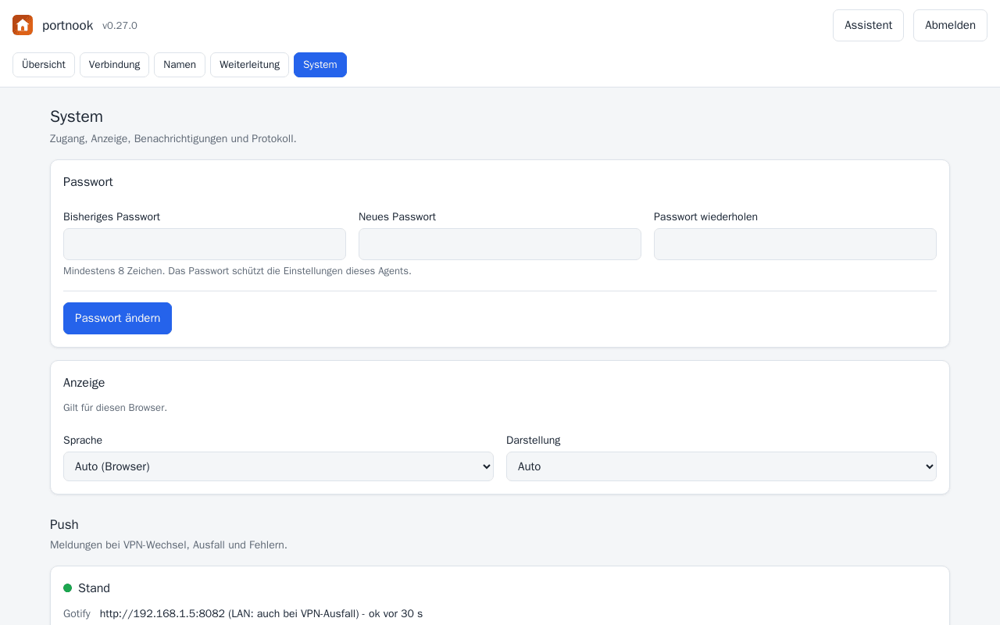

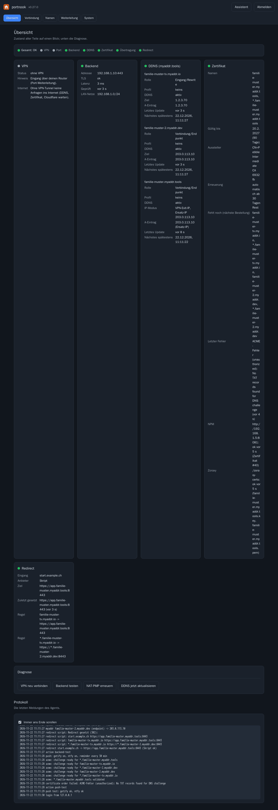

## So funktioniert es

```
Besucher ──https://app.<name>.myaddr.tools:<Port>──> Proton-Exit-IP:<Port>
                                                     │ WireGuard (wg0), von zuhause aufgebaut
                                              portnook (Docker)
                                                     │ DNAT nur auf den NAT-PMP-Port
                                              Reverse Proxy (NPM, Zoraxy, …) ─> Webdienst
```

Schnittstellen, Entscheide und geprüfte Quellen (myaddr.tools, NPM, Zoraxy, Cloudflare): [docs/concept.md](docs/concept.md)

## In 5 Minuten starten

Die ausführliche Anleitung mit Unraid, Zoraxy, NPM und Fehlersuche: **[docs/installation.md](docs/installation.md)**.
Anleitungen auf Englisch, auch zur Einrichtung von Zoraxy und Nginx Proxy Manager (Port 443 oder eigener Port):
**[Wiki](https://github.com/ghostgw-nook/portnook/wiki)**.

1. **Voraussetzungen:** Docker-Host zuhause (Linux ≥ 5.6), Reverse Proxy im LAN, Proton VPN mit
   Port-Forwarding (NAT-PMP), Name bei myaddr.tools (optional).
2. **Agent starten:**

   ```bash
   mkdir portnook && cd portnook
   curl -fsSLO https://raw.githubusercontent.com/ghostgw-nook/portnook/main/agent/docker-compose.yml
   echo "PF_BIND=192.168.1.20" > .env   # LAN-IP des Docker-Hosts
   docker compose up -d
   ```

3. **Assistent** unter `http://192.168.1.20:8090`, danach unter **Namen** Name, Schlüssel und Ziel eintragen.

Unraid ohne Compose-Plugin: Vorlage [`agent/unraid/portnook.xml`](agent/unraid/portnook.xml), siehe
[Anleitung](docs/installation.md#agent-auf-unraid-mit-vorlage-ohne-compose-plugin).

Updates: `docker compose pull && docker compose up -d`. Backup: das Verzeichnis `./data` (enthält Geheimnisse,
nie einchecken).

## Sicherheit

- **Keine offenen Ports zuhause:** Das WebUI hört nur auf der mit `PF_BIND` gewählten LAN-Adresse (Standard
  `127.0.0.1`). Von Proton aus ist nur der NAT-PMP-Port erreichbar, und nur Richtung Reverse Proxy.
- **Heim-IP bleibt verborgen:** Anfragen an myaddr.tools, Let's Encrypt und Cloudflare gehen nur durch den
  Tunnel; ist er unten (oder gibt es kein VPN), wird nichts gesendet, sondern vorgemerkt. Zusätzlich sperrt eine
  Firewall-Regel (`PF_OUT`) neue Verbindungen über `eth0` zu öffentlichen Adressen. Ausnahme: Push-Meldungen
  gehen bewusst direkt (seit 0.18.0), damit der Ausfall-Alarm ankommt; der Push-Dienst sieht die Heim-IP.
  Anfragen an NPM und Push-Server im LAN gehen nur ins LAN.
- **Tokens für Push** (Gotify, ntfy) sind nur schreibend und werden nie geloggt.
- **Geheimnisse nur schreibend:** myaddr-Schlüssel, NPM-Passwort, Cloudflare-Token, Abruf-Token und private
  Schlüssel werden nie angezeigt oder geloggt; gespeichert mit Dateirechten 600 in `/data`.
- **Proton-Konfiguration bereinigt:** `DNS`, IPv6 und Skript-Einträge wie `PostUp` werden beim Upload entfernt.

## Status und Grenzen

- Version siehe [VERSION](VERSION).
- In CI end-to-end getestet: Assistent, DDNS gegen ein nachgebautes myaddr.tools, ACME gegen **pebble** (Test-CA
  von Let's Encrypt), Übergabe an ein nachgebautes NPM und einen Zoraxy-Ordner, Abruf per Token, Redirect-Skript,
  VPN-Failover mit zwei WireGuard-Gegenstellen, Sperre ohne Tunnel (keine Anfrage ins Internet, Nachsenden danach)
  und Push an nachgebaute Gotify/ntfy-Server.
- **Nicht live getestet:** echtes Let's Encrypt, echtes myaddr.tools, echtes NPM, echtes Zoraxy, echte
  Cloudflare-API, echtes Proton-Konto, echtes Gotify/ntfy. Die Schnittstellen sind am offenen Quellcode bzw. an der Dokumentation
  geprüft (siehe [docs/concept.md](docs/concept.md)).
- Unraid-Variante (`agent/compose.unraid.yaml`) ist noch nicht auf einem echten Unraid-Server getestet.

## Lizenz

Copyright (C) 2026 helmi1987. portnook ist freie Software unter der
[GNU Affero General Public License v3.0](LICENSE): Du darfst es nutzen, verändern und weitergeben. Wer eine
veränderte Version weitergibt oder für andere als Dienst im Netz betreibt, muss den Quellcode dieser Version unter
derselben Lizenz zugänglich machen.

## Automatisierung (aus repo-template)

- **Auto-Merge:** Ein Push auf `claude/**` startet `tests.yml`; wenn grün, wird nach `main` gemergt, mit `vX.Y.Z`
  aus `VERSION` getaggt (wenn der Tag neu ist), als GitHub-Release veröffentlicht, gebaut und deployt
  (`build.yml`); gemergte `claude/**`-Branches werden gelöscht (`.github/workflows/auto-merge.yml`).
  Ändert sich nichts am Container (nur Doku, README, Screenshots, Wiki, Unraid-Vorlage), fallen Image- und
  e2e-Tests sowie der Image-Build weg; `VERSION` bleibt dann gleich.
- **Dependabot:** Patch- und Minor-Updates werden nach den Tests gemergt, mit Patch-Erhöhung von `VERSION`, Tag,
  Release und Build; der Dependabot-Branch wird gelöscht. Major-Updates bleiben für eine manuelle Prüfung offen
  (`.github/workflows/dependabot-auto-merge.yml`, `.github/dependabot.yml`).
- **Releases:** Jeder Tag bekommt ein GitHub-Release; Notizen aus `.github/release-notes/X.Y.Z.md`, sonst die
  Commit-Betreffs seit dem vorherigen Tag. Fehlende Releases werden nach jedem Merge nachgetragen oder über
  Actions → Releases → Run workflow.
- **Screenshots und Logos** (nicht in CI): `.github/scripts/screenshots.sh` erzeugt die Bilder in
  `docs/images/screenshots/` aus den echten Oberflächen, `.github/scripts/logos.sh` die PNGs in
  `docs/images/logo/` aus den SVGs.

### Einrichtung nach „Use this template“

1. Settings → Actions → General → Workflow permissions: „Read and write permissions“ und
   „Allow GitHub Actions to create and approve pull requests“.
2. Settings → General → „Automatically delete head branches“.
3. Settings → Code security: Dependabot alerts und Dependabot security updates an.
4. `main` muss Pushes von GitHub Actions annehmen (kein Branch-Schutz und kein Ruleset, das blockiert).

Für dieses Repository erledigt: Einstellungen 1–4, echte Tests (`tests.yml`: Unit-Tests,
Image-Smoke-Checks, End-to-end-Test `.github/scripts/e2e.sh` mit pebble als ACME-Server), Image-Build und Push
nach GHCR (`build.yml`, plus wöchentlicher Rebuild), Dependabot für `github-actions` und `docker`.
