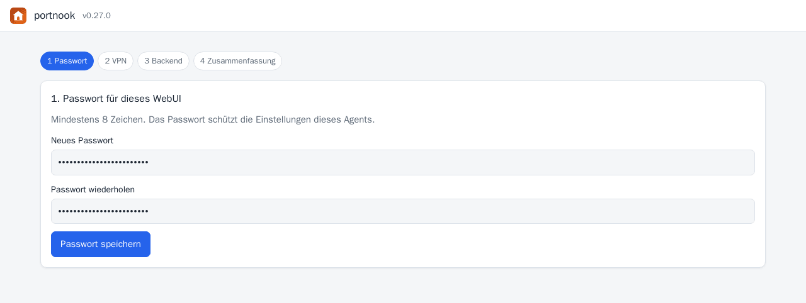
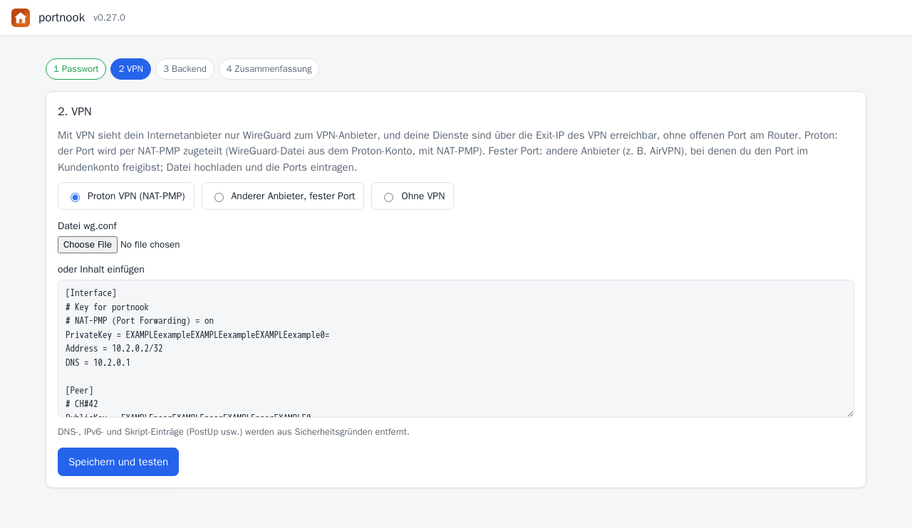
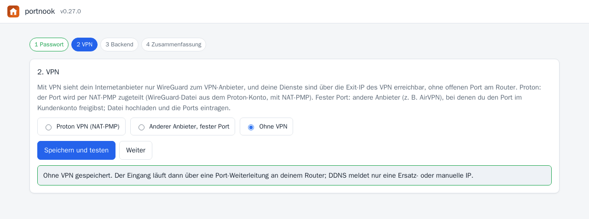
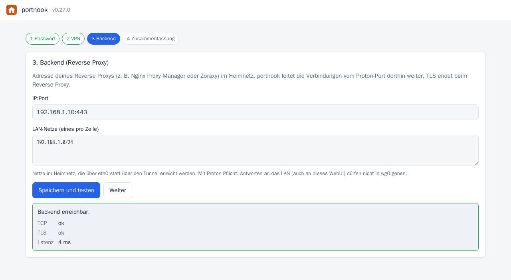
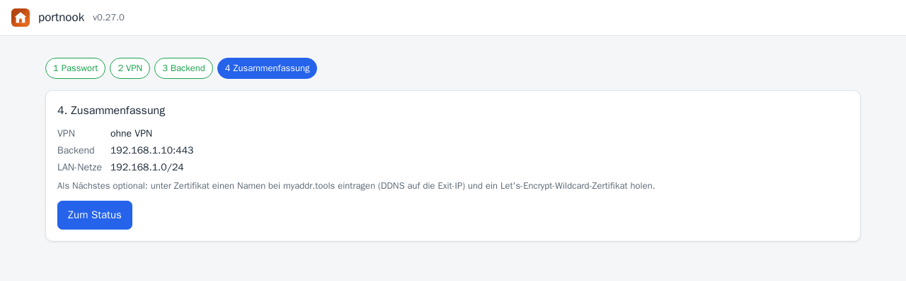
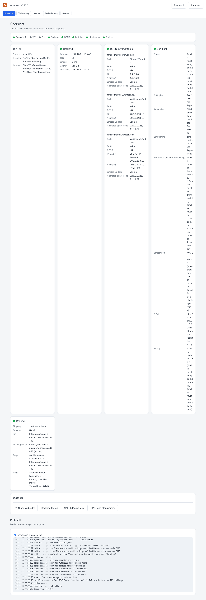
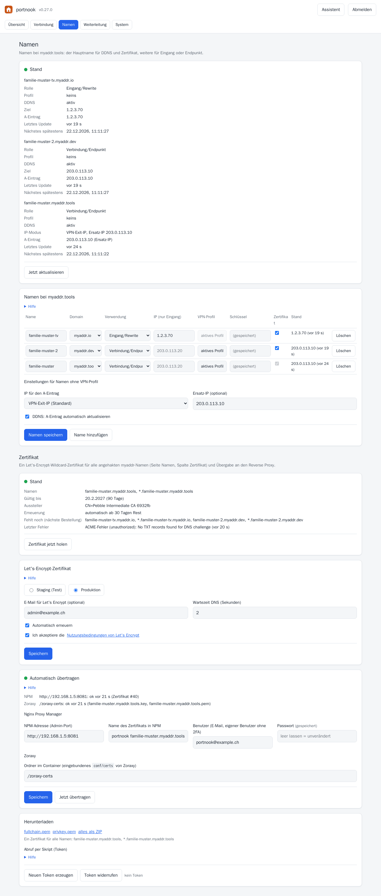
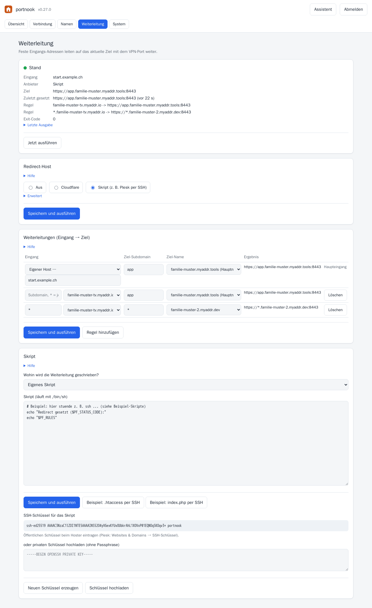
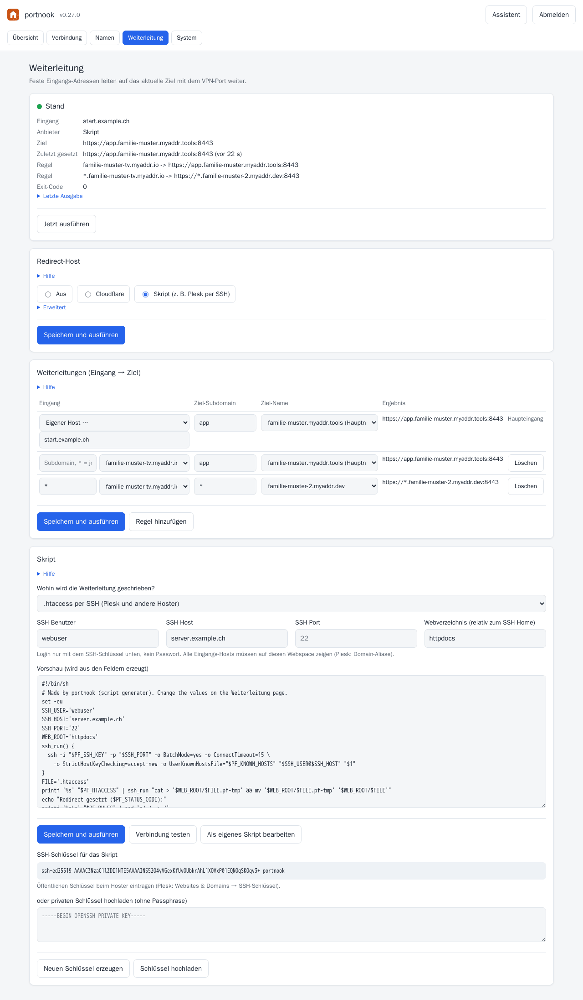
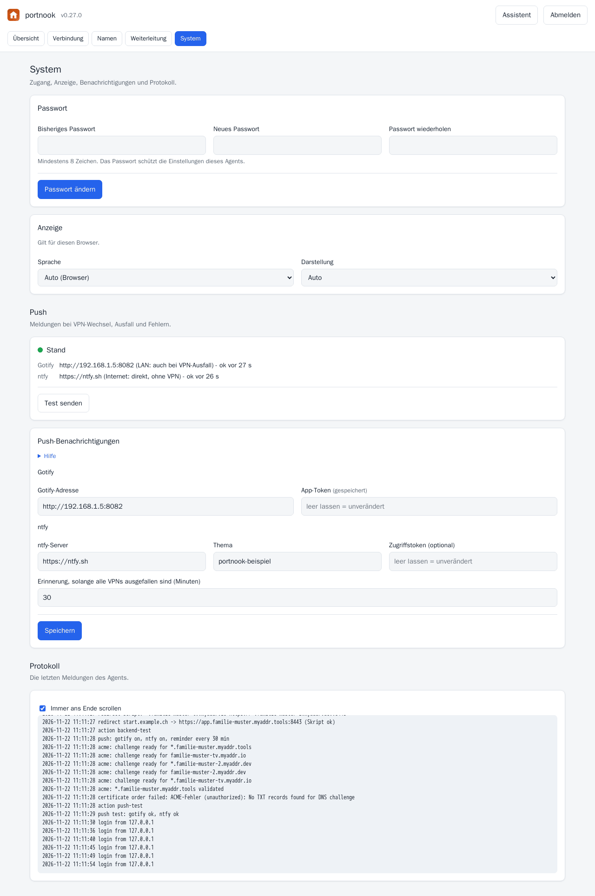

# Installation

Diese Anleitung führt von einem leeren Docker-Host zuhause bis zum Webdienst, der über die Proton-Exit-IP mit
eigenem Namen und gültigem Zertifikat erreichbar ist. Alle Adressen sind Beispielwerte: Docker-Host
`192.168.1.20`, Reverse Proxy `192.168.1.10:443`, Name `familie-muster.myaddr.tools`.

Die Screenshots stammen aus einem echten Durchlauf mit Beispielwerten
([`.github/scripts/screenshots.sh`](../.github/scripts/screenshots.sh)).

## Inhalt

1. [Voraussetzungen](#1-voraussetzungen)
2. [Agent starten](#2-agent-starten) ([Variante Unraid](#agent-auf-unraid-docker-compose-manager-plugin))
3. [Assistent](#3-assistent) ([Mehrere VPN-Profile](#mehrere-vpn-profile-failover))
4. [Name bei myaddr.tools und DDNS](#4-name-bei-myaddrtools-und-ddns)
5. [Let's-Encrypt-Zertifikat](#5-lets-encrypt-zertifikat)
6. [Zertifikat an den Reverse Proxy übergeben](#6-zertifikat-an-den-reverse-proxy-übergeben)
   ([Nginx Proxy Manager](#nginx-proxy-manager), [Zoraxy](#zoraxy), [Download und Skript](#download-und-abruf-per-skript))
7. [Redirect-Host (feste Eingangs-Adresse)](#7-redirect-host-feste-eingangs-adresse)
8. [Push-Benachrichtigungen](#8-push-benachrichtigungen)
   ([Intern direkt, extern über VPN](#intern-direkt-extern-über-vpn))
9. [Prüfen](#9-prüfen)
10. [Updates und Umstieg von 0.8](#10-updates-und-umstieg-von-08)
11. [Backup](#11-backup)
12. [Fehlersuche](#12-fehlersuche)

## 1. Voraussetzungen

- Docker-Host im Heimnetz mit Linux ≥ 5.6 (WireGuard im Kernel), z. B. Unraid, Debian, Ubuntu, Synology mit
  Container Manager.
- Ein Reverse Proxy im LAN, der TLS spricht (Nginx Proxy Manager, Zoraxy, Caddy, …) und den Webdienst kennt.
- Proton VPN mit einem Plan, der Port-Forwarding erlaubt. Im Proton-Konto unter **Downloads → WireGuard** eine
  Konfiguration mit **NAT-PMP (Port Forwarding)** für einen P2P-Server erzeugen.
- Optional ein Name bei [myaddr.tools](https://myaddr.tools): Name reservieren und den angezeigten Schlüssel
  sicher aufbewahren (er wird dort nur einmal angezeigt).

Statt Proton geht auch ein anderer Anbieter mit **festem Port** (z. B. AirVPN): im Kundenkonto einen Port
freigeben und eine WireGuard-Datei erzeugen. Ohne VPN geht es auch: Dann fehlt der Tunnel, und der Eingang ist eine
Port-Weiterleitung an deinem Router. Zertifikat und Übergabe funktionieren trotzdem; DDNS meldet dann nur eine
Ersatz- oder manuelle IP, nie die IP deines Anschlusses.

## 2. Agent starten

`agent/docker-compose.yml` auf den Docker-Host kopieren. Daneben eine `.env` mit der LAN-Adresse des Hosts
anlegen, sonst ist das WebUI nur auf dem Host selbst (`127.0.0.1`) erreichbar:

```bash
mkdir portnook && cd portnook
curl -fsSLO https://raw.githubusercontent.com/ghostgw-nook/portnook/main/agent/docker-compose.yml  # oder kopieren
echo "PF_BIND=192.168.1.20" > .env   # LAN-IP des Docker-Hosts
docker compose up -d
```

Dann im Browser `http://192.168.1.20:8090` öffnen.

Die Compose-Datei setzt das Label `com.centurylinklabs.watchtower.enable=false`: Watchtower startet portnook
nicht automatisch neu, siehe [Updates](#10-updates-und-umstieg-von-08).

Für **Zoraxy** zusätzlich dessen Zertifikatsordner einbinden (in der Compose-Datei bereits als Kommentar
vorbereitet), siehe [Zoraxy](#zoraxy).

### Agent auf Unraid mit Vorlage (ohne Compose-Plugin)

Für den normalen Docker-Tab von Unraid gibt es die Vorlage [`agent/unraid/portnook.xml`](../agent/unraid/portnook.xml).
Sie setzt dasselbe wie die Compose-Datei: `NET_ADMIN`, die drei `sysctl`, das Watchtower-Label, `/data` in
`/mnt/user/appdata/portnook` und optional den Zoraxy-Ordner.

1. Die Datei als `my-portnook.xml` nach `/boot/config/plugins/dockerMan/templates-user/` kopieren, z. B. über
   die Freigabe `flash` (`\\tower\flash\config\plugins\dockerMan\templates-user\`) oder im Terminal mit
   `nano /boot/config/plugins/dockerMan/templates-user/my-portnook.xml` und den Inhalt einfügen.
2. **Docker** → **Add Container** → bei **Template** `portnook` wählen.
3. **Network Type:** `bridge` genügt. Für den [LAN-Eingang](#lan-eingang-portnook) `Custom: br0` mit fester IP
   wählen; dann gilt die Port-Zuordnung nicht, das WebUI ist unter dieser IP auf Port 8090.
4. Ohne Zoraxy das Feld **Zoraxy certificates** leer lassen. **Apply**, danach das WebUI über das Icon öffnen.

Updates: im Docker-Tab **Check for Updates** und **Apply update** (nicht automatisch, siehe
[Updates](#10-updates-und-umstieg-von-08)). 

### Agent auf Unraid (Docker Compose Manager Plugin)

Für Unraid gibt es [`agent/compose.unraid.yaml`](../agent/compose.unraid.yaml): Daten in
`/mnt/user/appdata/portnook`, Unraid-Labels für Icon und WebUI-Link.

1. Unter **Apps** das Plugin **Docker Compose Manager** installieren.
2. Unter **Docker** im Bereich Compose einen neuen Stack `portnook` anlegen und den Inhalt von
   `agent/compose.unraid.yaml` als Compose-Datei einfügen:

   ```yaml
   services:
     portnook:
       image: ghcr.io/ghostgw-nook/portnook:latest
       container_name: portnook
       restart: unless-stopped
       cap_add:
         - NET_ADMIN
       sysctls:
         - net.ipv4.conf.all.src_valid_mark=1
         - net.ipv4.ip_forward=1
         - net.ipv6.conf.all.disable_ipv6=1
       ports:
         - "${PF_BIND:-127.0.0.1}:8090:8090"
       volumes:
         - /mnt/user/appdata/portnook:/data
         # Zoraxy (optional): Zertifikatsordner aus appdata einbinden
         - /mnt/user/appdata/zoraxy/config/conf/certs:/zoraxy-certs
       labels:
         net.unraid.docker.managed: composeman
         # Watchtower soll portnook nicht neu starten (sonst kann sich der Proton-Port ändern)
         com.centurylinklabs.watchtower.enable: "false"
   ```

3. `PF_BIND` auf die LAN-IP des Unraid-Servers setzen (Env-Datei des Stacks, z. B. `PF_BIND=192.168.1.20`) oder
   in der `ports`-Zeile direkt eintragen.
4. **Compose Up**, dann das WebUI über den Link am Container öffnen.

Ohne Zoraxy die Zeile mit `/zoraxy-certs` weglassen. Der Pfad links muss zum Volume deines Zoraxy-Containers
passen: Zoraxy speichert unter `/opt/zoraxy/config/conf/certs`; ist `/opt/zoraxy/config` auf
`/mnt/user/appdata/zoraxy/config` gemappt, ist es wie oben.

**Icon:** Das Label `net.unraid.docker.icon` zeigt auf `portnook.png` in diesem Repository.

## 3. Assistent

### Schritt 1: Passwort

Mindestens 8 Zeichen. Es schützt das WebUI.



### Schritt 2: VPN

Die WireGuard-Datei hochladen oder einfügen. Die **LAN-Netze** kommen in Schritt 3.
**Speichern und testen** baut `wg0` auf, wartet auf den Handshake und fragt per NAT-PMP Exit-IP und Port ab.
`DNS`, IPv6 und Skript-Einträge (`PostUp` usw.) werden entfernt.

**Anderer Anbieter, fester Port:** WireGuard-Datei des Anbieters hochladen und die dort freigegebenen Ports
eintragen (z. B. `43210`, mehrere mit Komma). Es gibt kein NAT-PMP; portnook leitet nur diese Ports an den
Reverse Proxy weiter und ermittelt die Exit-IP alle 5 Minuten über den Tunnel (IP-Echo von addr.tools).



Ohne VPN „Ohne VPN“ wählen (dann gibt es keine Anfragen ins Internet, also kein DDNS, kein Zertifikat und keinen
Cloudflare-Redirect; siehe [Ohne VPN-Tunnel](#ohne-vpn-tunnel-keine-anfragen-ins-internet)):



### Schritt 3: Backend (Reverse Proxy)

IP und TLS-Port des Reverse Proxys, z. B. `192.168.1.10:443`. portnook leitet den Proton-Port dorthin weiter
und prüft alle 30 s den TLS-Handshake (mit dem myaddr-Namen als SNI, sobald er eingetragen ist).

Dazu die **LAN-Netze** (Standard: alle privaten Netze `10.0.0.0/8`, `172.16.0.0/12`, `192.168.0.0/16`; das Netz im
Tunnel, bei Proton `10.2.0.0/24`, nimmt portnook automatisch aus). Mit Proton sind sie Pflicht: Antworten an dein
Heimnetz (auch an dieses WebUI) dürfen nicht in den Tunnel gehen. Später ändern: Seite **Verbindung**, Karte
**Backend**; das Passwort unter **System**.



### Schritt 4: Zusammenfassung



Danach zeigt die Statusseite die Ampel. Mit Proton steht dort der Port, z. B. `51234`: Der Webdienst ist ab
jetzt unter `https://<Exit-IP>:51234` erreichbar (mit dem Zertifikat deines Reverse Proxys).



### Mehrere VPN-Profile (Failover)

Falls ein VPN einmal ausfällt, kann portnook auf ein anderes wechseln. Seite **Verbindung**, Karte **VPN-Profile
(Failover)**: Mit **Neues Profil** weitere Zugänge anlegen (Name, Art Proton oder fester Port mit Ports,
WireGuard-Datei). Das Profil aus dem Assistenten ist Profil 1. Ausgeschaltete Profile werden übersprungen.
**Aktivieren** wechselt sofort von Hand.

- **Reihenfolge = Priorität** (seit 0.24.0): Die Liste bleibt so, wie du sie mit den Pfeilen sortierst (1 = wichtigstes),
  auch nach einem Wechsel. Reserve und erster Kandidat beim Failover ist das oberste eingeschaltete Profil, das
  gerade nicht aktiv ist. Es wird nie automatisch zurückgewechselt: Läuft Profil 2 und erholt sich Profil 1, steht
  Profil 1 als Reserve bereit und übernimmt erst, wenn Profil 2 ausfällt.
- **Reserve-Tunnel** (Standard an): Das oberste eingeschaltete Profil, das nicht aktiv ist, läuft dauernd als zweiter Tunnel mit,
  mit eigenem Port (NAT-PMP oder fest) und eigener Exit-IP; eingehende Verbindungen auf seinem Port gehen zum
  Reverse Proxy, die Antworten durch denselben Tunnel zurück. Anfragen ins Internet (DDNS, Zertifikat,
  Cloudflare) gehen nur über den aktiven Tunnel. Bei Proton braucht die Reserve einen zweiten Geräteplatz
  (eigene WireGuard-Datei pro Profil).
- portnook prüft den aktiven Tunnel alle 30 Sekunden: Tunnel läuft, Handshake jünger als 3 Minuten, Proton:
  NAT-PMP antwortet, fester Port: Exit-IP über den Tunnel ermittelbar.
- Nach **2 Fehlprüfungen in Folge** (einstellbar; nach dem ersten Fehler wird alle 5 Sekunden geprüft)
  **übernimmt die Reserve sofort**: kein Neuaufbau, Port und Exit-IP sind schon bekannt, DDNS und Redirect-Host
  ziehen gleich nach. Das ausgefallene Profil wird danach als neue Reserve aufgebaut und übernimmt erst wieder,
  wenn es gesund ist. Ist die Reserve selbst nicht bereit, startet wie früher das nächste Profil neu.
- **Eigener Name pro Profil** (empfohlen mit Reserve): Unter **myaddr.tools** → **Weitere myaddr-Namen** einen
  Namen mit Verwendung „Verbindung/Endpunkt“ anlegen und das VPN-Profil wählen. Der Name zeigt dann immer auf die
  Exit-IP dieses Profils, auch solange es Reserve ist, und der Redirect nimmt ihn, sobald das Profil aktiv ist.
  So muss beim Wechsel keine DNS-Änderung abgewartet werden. Seit 0.25.0 kann ein Name auch mehrere Profile haben:
  Er zeigt dann auf das aktive davon, sonst auf das, das als Reserve bereitsteht. Das Zertifikat deckt alle diese Namen mit ab
  (je mit `*.`); beim Reverse Proxy die Namen als weitere Domains eintragen.
- **Check nach jedem Wechsel** (Failover, Rotation, von Hand): portnook prüft alle 5 Sekunden, ob der A-Eintrag
  bei myaddr.tools auf der neuen Exit-IP steht und der Redirect-Host auf das neue Ziel zeigt. Das Ergebnis steht
  unter **Ereignisse**; klappt es nicht innert 5 Minuten, kommt zusätzlich eine Push-Nachricht.
- **Rotation** (Feld **Wann wechseln?**, Standard „nur bei Ausfall“; Fehlprüfungen und Wartezeit unter **Erweitert**): wechselt nach Zeitplan auf das nächste eingeschaltete Profil unterhalb des aktiven (nach dem letzten wieder das erste), **täglich** zu einer
  Uhrzeit (Zeitzone `TZ` des Containers, in den Compose-Dateien `Europe/Zurich`) oder **alle N Stunden**. Ist das
  nächste Profil gestört, geht es sofort zurück. Ist das Ziel die bereite Reserve, ist die Rotation nur ein Umschalten auf sie.
- Sind **alle** Profile gestört, bleibt der Verkehr gesperrt (Kill-Switch, nie über deine Heimleitung), die Ampel
  ist rot, DDNS meldet höchstens die Ersatz-IP, sonst nichts. Nach der Wartezeit beginnt eine neue Runde.
- Jeder Wechsel steht unter **Ereignisse** und im Log. Eine Push-Benachrichtigung gibt es (noch) nicht.

### MTU des Tunnels

Pro Profil lässt sich die **MTU** von `wg0` festlegen (**Bearbeiten** → **Erweitert** → **MTU des Tunnels**): ein fester Wert von 1280 bis 1500
oder **aus Konfiguration übernehmen** (die `MTU =`-Zeile der hochgeladenen `wg.conf`; fehlt sie, nimmt WireGuard
1420). Sie gilt beim Start des Tunnels und bei jedem Wechsel des Profils (Failover, Aktivieren).

- **1420**: ein einzelnes WireGuard über eine normale Leitung (1500 − 80 Byte WireGuard über IPv6).
- **1340** (Standard): Platz für WireGuard **doppelt verschachtelt**, z. B. dein Heim-VPN (WireGuard am Router)
  läuft über einen Weg, der selbst schon WireGuard ist (1500 − 80 − 80).
- **1280**: wenn Videos hängen bleiben, grosse Seiten oder Uploads abbrechen, kleine Seiten aber gehen (typisch für
  zu grosse Pakete, die unterwegs verworfen werden). 1280 ist das Minimum für IPv6.

Zusätzlich passt portnook die TCP-Segmentgrösse (**MSS = MTU − 40**) aller Verbindungen an, die durch `wg0` laufen,
in beide Richtungen. So funktionieren auch Geräte, deren eigene
MTU zu gross ist. Profile aus älteren Versionen erhalten beim Update 1340, ausser ihre `wg.conf` setzt eine MTU:
dann bleibt „aus Konfiguration“. Die aktuelle MTU steht auf der Übersicht in der VPN-Karte.

## 4. Name bei myaddr.tools und DDNS

Seite **Namen**, Karte **Name bei myaddr.tools**: Name (z. B. `familie-muster`), Domain (`myaddr.tools`,
`myaddr.dev` oder `myaddr.io`) und den Schlüssel eintragen, **Speichern**. Der Schlüssel wird gespeichert
(Dateirechte 600) und nie wieder angezeigt; zum Ändern einfach einen neuen eingeben.

- **IP für den A-Eintrag**, Standard **VPN-Exit-IP**: portnook setzt den A-Eintrag auf die Exit-IP des VPN,
  sobald sie bekannt ist, bei jeder Änderung und mindestens alle 30 Tage (myaddr deaktiviert Einträge nach 90
  Tagen ohne Update und löscht Namen nach 120 Tagen).
- **Ersatz-IP** (optional, z. B. die IP deines Hosters oder `127.0.0.1`): wird gemeldet, solange die Exit-IP
  unbekannt ist. Ohne Ersatz-IP gibt es dann **kein Update**, der alte Eintrag bleibt, und die Karte zeigt den
  Grund. Auch diese Anfragen laufen nur durch den Tunnel: ohne Tunnel wird das Update vorgemerkt (siehe
  [Ohne VPN-Tunnel](#ohne-vpn-tunnel-keine-anfragen-ins-internet)).
- **Manuell festgelegte IP** (IPv4 oder IPv6): wird immer gemeldet, Erneuerung alle 30 Tage.
- Die öffentliche IP deines Anschlusses meldet portnook **nie** (kein `ip=self`). Wer mit 0.9.0 ohne Proton
  lief, hat bei myaddr.tools evtl. noch die Anschluss-IP stehen: Ersatz- oder manuelle IP setzen, dann wird sie
  beim nächsten Update ersetzt.
- Alle Unternamen zeigen auf dieselbe IP: `app.familie-muster.myaddr.tools`, `cloud.…` usw. Im
  Reverse Proxy pro Dienst einen Proxy-Host mit diesem Namen anlegen.

## 5. Let's-Encrypt-Zertifikat

Karte **Let's-Encrypt-Zertifikat**:

1. Zuerst **Staging (Test)** wählen, die Nutzungsbedingungen von Let's Encrypt akzeptieren, optional eine E-Mail
   eintragen, **Zertifikat jetzt holen**. portnook legt die DNS-01-Prüfwerte bei myaddr.tools ab, wartet die
   eingestellte Zeit (Standard 60 s) und lässt Let's Encrypt prüfen. Ergebnis und Fortschritt stehen in der
   Karte und im Log.
2. Klappt das, auf **Produktion** umstellen und noch einmal holen. Staging-Zertifikate sind nicht
   vertrauenswürdig, haben aber keine engen Rate-Limits.

Das Zertifikat gilt für `familie-muster.myaddr.tools` und `*.familie-muster.myaddr.tools`. Mit „Automatisch
erneuern“ holt portnook ein neues, wenn weniger als 30 Tage übrig sind, und übergibt es sofort.



## 6. Zertifikat an den Reverse Proxy übergeben

Karte **Automatisch übertragen**. Nach jedem neuen Zertifikat werden alle eingetragenen Ziele beliefert;
**Jetzt übertragen** macht das sofort. Die Verbindungen gehen nur über das LAN, nie durch den Tunnel.

### Nginx Proxy Manager

1. In NPM unter **Users** einen eigenen Benutzer für portnook anlegen, **ohne 2FA**, mit der Berechtigung
   **Certificates: Manage** (Rest „Hidden“ genügt).
2. In portnook: NPM-Adresse mit Admin-Port (z. B. `http://192.168.1.10:81`), E-Mail und Passwort dieses
   Benutzers. Der Name des Zertifikats in NPM ist frei wählbar (Standard `portnook <name>.myaddr.tools`).
3. **Speichern**, dann **Jetzt übertragen**. portnook legt in NPM ein eigenes Zertifikat („Custom“) an und lädt
   Zertifikat, Schlüssel und Zwischenzertifikat hoch.
4. In NPM bei den Proxy-Hosts (`app.familie-muster.myaddr.tools` usw.) unter **SSL** dieses Zertifikat
   wählen.

Bei jeder Erneuerung wird **dasselbe** NPM-Zertifikat ersetzt; die Proxy-Hosts bleiben unverändert.

### Zoraxy

1. Den Zertifikatsordner von Zoraxy in portnook einbinden (`…/zoraxy/config/conf/certs:/zoraxy-certs`, siehe
   [Abschnitt 2](#agent-auf-unraid-docker-compose-manager-plugin)) und den Container neu erstellen.
2. In portnook als Zoraxy-Ordner `/zoraxy-certs` eintragen, **Speichern**, **Jetzt übertragen**.
3. portnook schreibt `familie-muster.myaddr.tools.pem` (ganze Kette) und `familie-muster.myaddr.tools.key`.
4. **Zoraxy einmal neu starten**, damit es die neue Datei auch für die Unternamen (Wildcard) findet. Danach
   übernimmt Zoraxy Erneuerungen ohne Neustart, weil es die Dateien bei jeder Verbindung liest.

### Download und Abruf per Skript

- In der Karte **Herunterladen**: `fullchain.pem`, `privkey.pem` oder alles als ZIP.
- Für andere Geräte: **Neuen Token erzeugen** (wird nur einmal angezeigt) und
  [`docs/pull-cert.sh`](pull-cert.sh) verwenden, z. B. täglich per Cron:

  ```bash
  echo '<Token>' > /root/.pf-token && chmod 600 /root/.pf-token
  PF_AGENT=http://192.168.1.20:8090 PF_TOKEN_FILE=/root/.pf-token DEST=/etc/ssl/pf \
    RELOAD="systemctl reload nginx" ./pull-cert.sh
  ```

  Das Skript ersetzt die Dateien nur, wenn sich das Zertifikat geändert hat, und führt dann `RELOAD` aus.

## 7. Redirect-Host (feste Eingangs-Adresse)

Der Proton-Port ändert sich ab und zu, und myaddr.tools kann selbst nicht weiterleiten. Seite **Weiterleitung** (Redirect-Host): Eine
feste Adresse wie `https://start.example.ch` leitet mit 302 auf
`https://app.familie-muster.myaddr.tools:<aktueller Port>` weiter. Pfad und Query bleiben erhalten.
portnook führt den Anbieter bei jeder Änderung von Exit-IP oder Port aus, einmal nach dem Speichern und mit
**Jetzt ausführen**.

> **Manche Apps** merken sich das Ziel der Weiterleitung, nicht die Eingangs-Adresse. Nach einer
> Port-Änderung die Eingangs-Adresse dort neu eintragen. Eine bessere Lösung ist ein späterer Meilenstein.



### Mit Cloudflare

1. Die Domain des Eingangs (z. B. `example.ch`) liegt bei Cloudflare. Für `start.example.ch` einen DNS-Eintrag mit
   Proxy (orange Wolke) anlegen, z. B. `AAAA 100::`.
2. API-Token erstellen: **My Profile → API Tokens → Create Token**, Berechtigung **Zone → Single Redirect →
   Edit**, nur für diese Zone. Mit Zone-ID statt Domain ist keine weitere Berechtigung nötig (sonst zusätzlich
   Zone → Zone → Read).
3. In portnook: Anbieter Cloudflare, Eingangs-Host `start.example.ch`, Ziel-Unterdomain `app`, Zone und Token,
   **Speichern und ausführen**. portnook legt eine Regel „portnook redirect start.example.ch“ an und aktualisiert
   nur diese.

### Mit Skript (z. B. Plesk-Webhosting per SSH)

1. Anbieter **Skript** wählen. Unter **Wohin wird die Weiterleitung geschrieben?** „.htaccess per SSH“ (oder
   „index.php per SSH“) wählen und **SSH-Benutzer**, **SSH-Host**, **SSH-Port** und **Webverzeichnis** (z. B.
   `httpdocs`) eintragen. portnook erzeugt das Skript daraus selbst; die Vorschau zeigt es. Von Hand anpassen geht
   mit **Als eigenes Skript bearbeiten** (oder „Eigenes Skript“ wählen).
2. **Neuen Schlüssel erzeugen** und den angezeigten öffentlichen Schlüssel im Hosting eintragen (Plesk: Websites
   & Domains → SSH-Schlüssel bzw. SSH-Zugang aktivieren). Alternativ einen eigenen privaten Schlüssel ohne
   Passphrase hochladen.
3. Eingangs-Host (z. B. `start.example.ch`) und Ziel-Unterdomain eintragen, **Speichern und ausführen**. Das Skript
   schreibt eine `.htaccess` mit `RewriteRule … [R=302]` in den Webroot; `/.well-known/` bleibt ausgenommen,
   damit Plesk sein eigenes Let's-Encrypt-Zertifikat für den Eingangs-Host erneuern kann.
   **Verbindung testen** schreibt vorher eine Testdatei ins Webverzeichnis, liest sie und löscht sie wieder; dabei
   wird der Server-Schlüssel gespeichert und sein Fingerabdruck angezeigt.
4. Exit-Code und die letzten 50 Zeilen der Ausgabe stehen unter **Letzte Ausgabe**.



Das Skript bekommt `PF_TARGET_URL`, `PF_TARGET_HOST`, `PF_PORT`, `PF_IP`, `PF_STATUS_CODE`, `PF_ENTRY_HOST`,
`PF_SSH_KEY` und `PF_KNOWN_HOSTS`, seit 0.13.0 auch `PF_RULES` (alle Regeln, eine `<Eingang> <Ziel>` pro Zeile)
sowie `PF_HTACCESS` und `PF_PHP` (fertige Dateien für alle Regeln, Cache aus), und läuft höchstens 60 s. Ein
zweites Beispiel schreibt eine `index.php` mit Weiterleitung (für Hostings ohne `.htaccess`). **Eigene Skripte
von vor 0.13.0** funktionieren weiter für den Haupteingang; für weitere Regeln `PF_HTACCESS` bzw. `PF_PHP`
schreiben.

### Weitere Regeln, Subdomain auf Subdomain

Unter **Weitere Regeln** weitere Eingangs-Hosts eintragen, alle auf den aktuellen Port:

| Eingang | Ziel | Ergebnis |
|---|---|---|
| `eingang-muster.myaddr.io` | `tv` | `https://tv.<name>.myaddr.tools:<Port>` |
| `*.eingang-muster.myaddr.io` | `*` | `x.eingang-muster.myaddr.io` → `https://x.<name>.myaddr.tools:<Port>` |
| `alt.example.ch` | (leer) | `https://<name>.myaddr.tools:<Port>` |

`*.`-Regeln gehen nur mit dem Skript (Cloudflare: nur feste Hosts). Beim Skript müssen alle Eingangs-Hosts auf
denselben Webspace zeigen (Plesk: Domain-Aliase). Das Ziel ist immer `https://` (TLS endet bei deinem Reverse
Proxy); wird der Eingang mit `http://` aufgerufen, geht die Weiterleitung direkt aufs https-Ziel. Damit Browser
und Apps beim Eingang keinen Zertifikatsfehler zeigen, braucht der Eingangs-Host selbst ein Zertifikat (Plesk:
Let's Encrypt; bei `*.`-Regeln ein Wildcard-Zertifikat).

### Weitere myaddr-Namen (Eingang oder Endpunkt)

Seite **Namen**, Karte **Weitere myaddr-Namen**: Name, Domain, Verwendung und Schlüssel.

- **Eingang/Rewrite**: fester Name des Redirect-Servers (z. B. `familie-tv.myaddr.io` auf die feste IP des
  Plesk-Servers). Der Server holt sein Zertifikat dann selbst per HTTP-01.
- **Verbindung/Endpunkt**: zeigt wie der Hauptname auf die VPN-Exit-IP und folgt jedem Wechsel sofort.

Alle Namen erneuert portnook mindestens alle 30 Tage, damit myaddr sie nicht löscht. Nach einem VPN-Wechsel prüft
portnook auch die Endpunkt-Namen. Das Zertifikat gilt nur für den Hauptnamen. Der „zweite myaddr-Name“ der
Redirect-Seite (vor 0.13.0) wird automatisch zum ersten Eingangs-Namen.

## 8. Push-Benachrichtigungen

Seite **System**, Abschnitt **Push**: Gotify (Adresse und App-Token, in Gotify unter *Apps* angelegt) und/oder ntfy (Server, Thema,
optional ein Zugriffstoken) eintragen, **Speichern**, dann **Test senden**. Tokens werden gespeichert
(Dateirechte 600) und nie angezeigt; bei einer neuen Adresse den Token neu eintragen. Ein Feld leeren schaltet
das Ziel aus.

Meldungen gibt es bei einem VPN-Profilwechsel (Failover), dem Ausfall aller
VPNs, der Wiederherstellung, Fehlern bei DDNS, Zertifikat, Redirect, NPM und Zoraxy sowie bei einem erneuerten
Zertifikat. Solange alle VPNs ausgefallen sind, kommt eine Erinnerung (Standard alle 30 Minuten, einstellbar).
Gleiche Meldungen höchstens einmal pro Stunde, insgesamt höchstens 20 pro Stunde.

> **Push geht direkt (seit 0.18.0):** Push-Meldungen müssen die Heim-IP nicht verbergen. portnook sendet sie
> immer direkt über die Heimleitung (`eth0`), am VPN vorbei, auch an Server im Internet wie `https://ntfy.sh`.
> So kommen der Alarm „Alle VPNs ausgefallen“ und die Erinnerungen sofort an. Der Push-Dienst sieht dabei deine
> Heim-IP; alle anderen Anfragen (DDNS, Zertifikat, Redirect) bleiben im Tunnel. Die Firewall (`PF_OUT`) lässt
> dafür nur Verbindungen mit der Push-Markierung `0x5046` hinaus.



## Ohne VPN-Tunnel: keine Anfragen ins Internet

Seit 0.10.1 kontaktiert portnook ohne funktionierenden Tunnel (VPN aus, `wg0` unten, kein frischer Handshake
oder alle Profile gestört) **keinen** Dienst im Internet: kein myaddr.tools (auch keine Ersatz- oder manuelle
IP), kein Let's Encrypt, kein Cloudflare, kein IP-Echo, kein Redirect-Skript (mit VPN). Ausnahme seit 0.18.0:
Push-Meldungen gehen direkt (siehe Push). Die Karten zeigen dann „Wartet: Kein VPN-Tunnel … vorgemerkt“. Vorgemerkt wird jeweils nur der neueste
Stand; sobald ein Tunnel steht, sendet portnook ihn im nächsten Durchlauf (höchstens 30 s) durch `wg0`.
Erreichbar bleiben Ziele mit privater Adresse im LAN (NPM, Push-Server im LAN, der Zoraxy-Ordner).
Zusätzlich verwirft die Firewall-Kette `PF_OUT` neue Verbindungen über `eth0` zu öffentlichen Adressen (erlaubt:
LAN, DNS-Server, WireGuard-Endpunkte). **Ganz ohne VPN** arbeitet portnook deshalb nur im LAN.

## Intern direkt, extern über VPN

Ziel: dieselbe Adresse `https://<sub>.<name>.myaddr.tools:<PORT>` funktioniert überall, aber Geräte zuhause
(und im Heim-VPN) gehen **nicht** über Proton, sondern direkt zum Reverse Proxy.

### LAN-Eingang (portnook)

Seit 0.10.2 nimmt portnook den aktuellen VPN-Port (NAT-PMP-Port oder feste Ports) **auch auf seiner eigenen
LAN-IP** an und leitet ihn an denselben Reverse Proxy weiter wie den Port aus dem Tunnel. Ändert sich der Port
(Proton, Neustart, Failover auf ein anderes Profil), zieht der LAN-Eingang automatisch mit: der alte Port ist
zu, der neue offen. Das gilt nur eingehend aus dem LAN; ins Internet wird dadurch nichts geöffnet.

Im Status unter **LAN-Eingang** stehen LAN-Adresse und Port, dort lässt er sich auch ausschalten (Standard:
ein). Voraussetzungen:

- portnook hat eine **eigene LAN-IP** (Docker-Netz `ipvlan`/`macvlan`, auf Unraid z. B. „Custom: br0" mit
  fester IP). Im normalen Bridge-Netz mit `ports:` ist die Container-IP nur auf dem Docker-Host selbst
  erreichbar. Der Docker-Host selbst erreicht den Container in diesen Netzen nicht (Docker-Einschränkung).
- Der Reverse Proxy erlaubt Verbindungen von der LAN-IP von portnook (er sieht portnook als Absender, wie beim
  Weg über das VPN).

Seit 0.18.1 nimmt portnook die Verbindungen selbst an und reicht sie an den Reverse Proxy weiter (TCP-Proxy).
Bis 0.18.0 war das eine Firewall-Regel (DNAT). Die griff auf Unraid mit `br0` (ipvlan) nie, weil der Host die
Verbindung schon vorher erfasst; die Verbindung wurde abgewiesen („Connection refused“). Antworten gehen immer
über das LAN, nie in den Tunnel, auch an Heim-VPN-Clients, deren Netz nicht unter **LAN-Netze** steht. Kann
portnook auf einem Port nicht lauschen, steht das im Status unter **LAN-Eingang**.

### DNS mit Technitium

DNS kennt **keine Ports**: der Port bleibt in der URL, nur die IP ist intern eine andere. Darum zeigt intern
alles unter deinem Namen auf die LAN-IP von portnook; dieser Eintrag ist statisch und muss nie angepasst werden,
weil portnook dem Port folgt.

1. In Technitium unter **Zones** → **Add Zone** eine **Primary Zone** `<name>.myaddr.tools` anlegen (z. B.
   `familie-muster.myaddr.tools`).
2. Darin zwei A-Einträge auf die LAN-IP von portnook (z. B. `192.168.1.20`): `@` und `*`.
3. Für die feste Eingangs-Adresse des [Redirect-Hosts](#7-redirect-host-feste-eingangs-adresse) (z. B.
   `app.example.ch`) einen eigenen Eintrag (eigene Primary Zone oder A-Eintrag in der Zone deiner Domain)
   auf die **LAN-IP des Reverse Proxys**. Interne Geräte landen damit direkt auf Port 443 beim Reverse Proxy,
   ohne Redirect. Der Reverse Proxy braucht dafür einen Host und ein Zertifikat für diesen Namen.
4. Extern bleibt alles wie bisher: der öffentliche DNS zeigt auf die VPN-Exit-IP bzw. den Redirect-Host
   (302/307 auf das aktuelle Ziel).

Das Zertifikat ist davon nicht betroffen: Let's Encrypt prüft über den öffentlichen DNS von myaddr.tools.

**Heim-VPN (WireGuard, OpenVPN, Tailscale usw.):** Der VPN-Server muss den Handys und Laptops den Heim-DNS
(Technitium) mitgeben (bei WireGuard `DNS = <IP von Technitium>` in der Client-Konfiguration, bei Tailscale
„Override local DNS"). Sonst fragen die Geräte einen öffentlichen DNS, bekommen die Exit-IP und gehen über
Proton.

| Wo ist das Gerät? | DNS-Antwort für `<sub>.<name>.myaddr.tools` | Weg | Eingangs-Adresse (Redirect-Host) |
|---|---|---|---|
| Im LAN | LAN-IP von portnook (Technitium) | direkt: portnook (LAN-Eingang) → Reverse Proxy | direkt zum Reverse Proxy auf 443, ohne Redirect |
| Im Heim-VPN (mit Heim-DNS) | LAN-IP von portnook (Technitium) | Heim-VPN → portnook (LAN-Eingang) → Reverse Proxy | direkt zum Reverse Proxy auf 443, ohne Redirect |
| Im Heim-VPN ohne Heim-DNS | Exit-IP (öffentlicher DNS) | über Proton, wie von aussen | Redirect 302/307 |
| Unterwegs (aussen) | Exit-IP (öffentlicher DNS) | Proton → portnook (wg0) → Reverse Proxy | Redirect 302/307 auf `https://<sub>.<name>.myaddr.tools:<PORT>` |

## 9. Prüfen

```bash
docker exec portnook wg show wg0                                 # Handshake mit Proton
dig +short familie-muster.myaddr.tools                           # = Exit-IP
openssl s_client -connect familie-muster.myaddr.tools:<Port> \
  -servername app.familie-muster.myaddr.tools </dev/null | grep -E 'subject|issuer'
curl -sI https://start.example.ch/web/ | grep -i location           # Redirect-Host
```

Die Ampel auf der Statusseite fasst alles zusammen.

## 10. Updates und Umstieg von 0.8

```bash
docker compose pull && docker compose up -d
```

Die Images werden bei jedem Release und wöchentlich (Alpine-Sicherheitsupdates) neu gebaut.

**Watchtower:** Jeder Neustart baut `wg0` neu auf. portnook fragt Proton dann per NAT-PMP nach dem zuletzt
gehaltenen Port (pro Profil gespeichert in `/data/natpmp.json`); gibt Proton einen anderen, gilt der neue
(DDNS, Redirect und LAN-Eingang ziehen nach, Clients mit gespeichertem Ziel aber nicht). Darum in den
Compose-Dateien das Label `com.centurylinklabs.watchtower.enable=false` (oder
`com.centurylinklabs.watchtower.monitor-only=true`, dann meldet Watchtower neue Images nur) und von Hand
aktualisieren. **Empfehlung:** AirVPN mit festem Port als Profil 1 und Proton als Ausweichprofil
([Mehrere VPN-Profile](#mehrere-vpn-profile-failover)); der feste Port ändert sich bei Neustarts nie.

**Von 0.8 (mit VPS) auf 0.9:** Der Agent übernimmt Passwort, Proton und Backend. Die Anmeldung am VPS
(`wg-mgmt`, Token, Schlüssel) wird beim ersten Start gelöscht; der Assistent hat keinen Enrollment-Schritt mehr.
Den Edge-Container auf dem VPS stoppen und entfernen (`docker compose down` im Verzeichnis `pf-edge`), DNS-Einträge
deiner Domains auf den VPS bei Bedarf umstellen (z. B. auf den Redirect-Host).

## 11. Backup

Alle Daten liegen in `./data` (Unraid: `/mnt/user/appdata/portnook`): Zustand, Proton-Konfiguration,
myaddr-Schlüssel, Zertifikate und Schlüssel, ACME-Konto, SSH-Schlüssel (Dateirechte 600). Regelmässig sichern:

```bash
tar czf portnook-data-$(date +%F).tar.gz data
```

Das Backup enthält Geheimnisse: verschlüsselt aufbewahren und **nie** in ein Git-Repository einchecken.

## 12. Fehlersuche

| Symptom | Ursache und Abhilfe |
|---|---|
| WebUI aus dem LAN nicht erreichbar | `PF_BIND` in der `.env` fehlt oder falsch; danach `docker compose up -d` |
| Mit Proton bricht das WebUI ab | LAN-Netze im Proton-Schritt fehlen (seit 0.13.1 Standard: alle privaten Netze) |
| Über VPN kein Zugriff, obwohl `10.0.0.0/8` eingetragen (vor 0.13.1) | Das LAN-Netz deckte das Netz im Tunnel ab (NAT-PMP-Gateway `10.2.0.1`); ab 0.13.1 automatisch ausgenommen |
| Proton-Test: „ohne NAT-PMP erzeugt“ | Neue WireGuard-Datei mit NAT-PMP für einen P2P-Server erzeugen |
| DDNS: „VPN aus oder Exit-IP unbekannt, keine Ersatz-IP“ | VPN prüfen (Proton: „NAT-PMP erneuern“) oder eine Ersatz-IP eintragen |
| DDNS: „HTTP 400: invalid value for "key"“ | Schlüssel falsch oder Name bei myaddr.tools gelöscht (120 Tage ohne Update); neu registrieren |
| DDNS/Zertifikat/Redirect: „Kein VPN-Tunnel … vorgemerkt“ | Absichtlich: ohne Tunnel sendet portnook nichts ins Internet. Sobald ein VPN steht, wird nachgesendet |
| Push: „HTTP 401“ / „HTTP 403“ | App-Token (Gotify) oder Zugriffstoken/Thema (ntfy) falsch |
| Zertifikat: „ACME-Fehler (… unauthorized/dns)“ | TXT-Wert noch nicht sichtbar: „Wartezeit DNS“ erhöhen (z. B. 120 s) und erneut holen |
| Zertifikat: „rateLimited“ | Zu viele Versuche in Produktion; mit Staging testen und später erneut |
| NPM: „2FA“ | Für portnook einen eigenen NPM-Benutzer ohne 2FA anlegen |
| NPM: „keine private LAN-Adresse“ | NPM-Adresse muss im Heimnetz liegen (10.x, 172.16–31.x, 192.168.x) |
| Zoraxy: „Ordner existiert nicht“ | Volume `…/conf/certs:/zoraxy-certs` fehlt; Container neu erstellen |
| Zoraxy nutzt das Zertifikat für Unternamen nicht | Zoraxy nach der ersten Übertragung einmal neu starten |
| Redirect: „Ziel unbekannt (Port, Name oder IP fehlt)“ | Noch kein NAT-PMP-Port oder keine Exit-IP; ohne VPN „Fester Port“ und eine Ersatz-IP eintragen |
| Redirect-Skript: Code 255 / „Permission denied (publickey)“ | Öffentlichen Schlüssel beim Hoster eintragen, SSH-Zugang aktivieren |
| Redirect-Skript: Code 2 „anpassen“ | Platzhalter `CHANGE_ME` im Skript ersetzen |
| Ampel gelb/rot | Die Karte mit dem farbigen Punkt nennt die Ursache; Details im Log |
| Videos bleiben hängen, grosse Seiten laden nicht fertig | MTU des Profils auf 1280 stellen ([MTU des Tunnels](#mtu-des-tunnels)) |
