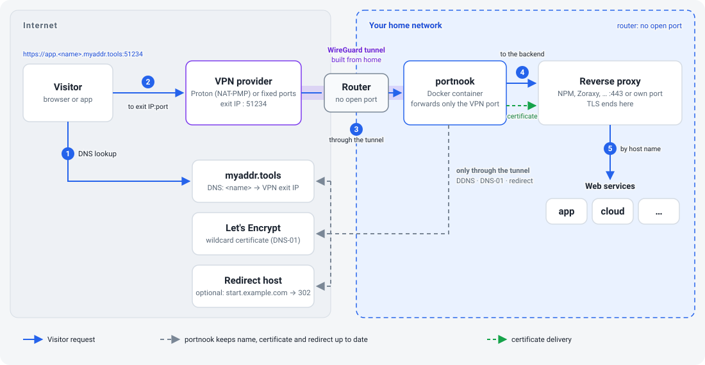

# How it works

> **Applies to:** portnook 0.27 (rc1) · [Versions](Versions)

*Deutsch: [So funktioniert es](So-funktioniert-es)*



The same path as text:

```
Visitor ──https://app.<name>.myaddr.tools:<port>──> VPN exit IP:<port>
                                                   │ WireGuard (wg0), built from home
                                            portnook (Docker, in your LAN)
                                                   │ forwards only the VPN port
                                            Reverse proxy (NPM, Zoraxy, …) :443 or own port
                                                   │ TLS ends here
                                            Web service
```

## The parts

| Part | Job |
|---|---|
| **VPN with port forwarding** | Proton VPN (NAT-PMP) or a provider with fixed ports (e.g. AirVPN). The tunnel is built *from* home, so the router needs no open port. The provider gives you a public port on its exit IP. |
| **portnook** | Runs the WireGuard tunnel, asks for the port (NAT-PMP) and keeps it alive, forwards that port to your reverse proxy, updates DNS, gets the certificate and hands it over. |
| **myaddr.tools** | Free DNS name (`<name>.myaddr.tools`, `.dev`, `.io`). portnook keeps its A record on the VPN exit IP. All subnames (`app.<name>…`) point to the same IP. |
| **Let's Encrypt** | Wildcard certificate for `<name>.myaddr.tools` and `*.<name>.myaddr.tools`, via DNS-01 at myaddr.tools. No port 80 needed. |
| **Reverse proxy** | Yours. It receives the forwarded port, picks the host by name (SNI/Host) and talks to the web service. portnook delivers the certificate to it. |
| **Redirect host** (optional) | A fixed address such as `start.example.com` that answers with a 302 to the current `https://<sub>.<name>.myaddr.tools:<port>`. |

## A request, step by step

1. The visitor opens `https://app.<name>.myaddr.tools:51234`. DNS answers with the VPN exit IP.
2. The VPN provider passes port 51234 through the tunnel to portnook.
3. portnook forwards the connection to the reverse proxy (the "backend", e.g. `192.168.1.10:443`). It does not
   look into the traffic; TLS is not terminated in portnook.
4. The reverse proxy shows the portnook certificate for `*.<name>.myaddr.tools`, finds the proxy host
   `app.<name>.myaddr.tools` and passes the request to the service.
5. The answer goes back the same way through the tunnel.

**Note:** the reverse proxy sees portnook's LAN IP as the source of every outside visitor. This matters for
access rules, see [Port 443 or a dedicated port](Reverse-proxy-port).

## When the port changes

Proton gives a port that can change (reconnect, restart, server change). portnook then:

- forwards the new port and closes the old one,
- updates the [redirect host](Redirect-host) so the fixed address points to the new port,
- moves the LAN entry to the new port.

The reverse proxy does **not** need to change: it always gets the connection on the same backend port.

## What never happens

- portnook never sends your home IP to myaddr.tools.
- Without a tunnel, portnook sends nothing to the internet (DDNS, Let's Encrypt, Cloudflare and redirect
  updates are queued). Push messages are the one exception, so the outage alarm can arrive.
- No traffic of other containers or devices goes through the tunnel; only portnook uses it.
