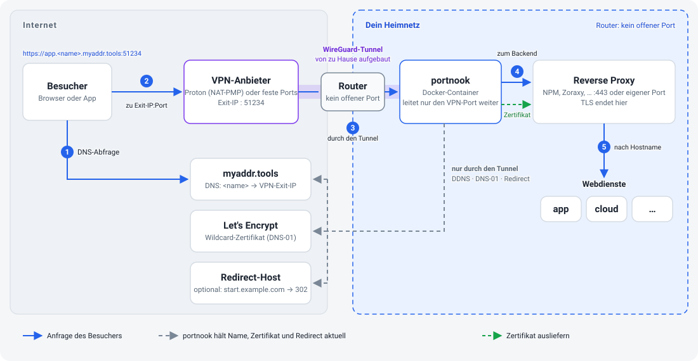

# So funktioniert es

> **Applies to:** portnook 0.27 (rc1) · [Versions](Versions)

*English: [How it works](How-it-works)*

## Die Teile

| Teil | Aufgabe |
|---|---|
| **VPN mit Port-Weiterleitung** | Proton VPN (NAT-PMP) oder ein Anbieter mit festen Ports (z. B. AirVPN). Der Tunnel wird *von zu Hause aus* aufgebaut, darum braucht der Router keinen offenen Port. Der Anbieter gibt dir einen öffentlichen Port auf seiner Exit-IP. |
| **portnook** | Betreibt den WireGuard-Tunnel, holt den Port (NAT-PMP) und hält ihn offen, leitet diesen Port an deinen Reverse Proxy weiter, aktualisiert den DNS-Eintrag, holt das Zertifikat und liefert es aus. |
| **myaddr.tools** | Kostenloser DNS-Name (`<name>.myaddr.tools`, `.dev`, `.io`). portnook hält den A-Eintrag auf der VPN-Exit-IP. Alle Unternamen (`app.<name>…`) zeigen auf dieselbe IP. |
| **Let's Encrypt** | Wildcard-Zertifikat für `<name>.myaddr.tools` und `*.<name>.myaddr.tools`, per DNS-01 bei myaddr.tools. Port 80 wird nicht gebraucht. |
| **Reverse Proxy** | Gehört dir. Er bekommt den weitergeleiteten Port, wählt den Host nach Name (SNI/Host) und spricht mit dem Webdienst. portnook liefert ihm das Zertifikat. |
| **Redirect-Host** (optional) | Eine feste Adresse wie `start.example.com`, die mit einem 302 auf das aktuelle `https://.<name>.myaddr.tools:<port>` antwortet. |

## Eine Anfrage, Schritt für Schritt

1. Der Besucher öffnet `https://app.<name>.myaddr.tools:51234`. DNS antwortet mit der VPN-Exit-IP.
2. Der Besucher verbindet sich mit Exit-IP und Port beim VPN-Anbieter.
3. Der Anbieter reicht Port 51234 durch den Tunnel an portnook weiter.
4. portnook leitet die Verbindung an den Reverse Proxy weiter (das «Backend», z. B. `192.168.1.10:443`). Es
   schaut nicht in den Verkehr; TLS endet nicht in portnook.
5. Der Reverse Proxy zeigt das portnook-Zertifikat für `*.<name>.myaddr.tools`, findet den Proxy-Host
   `app.<name>.myaddr.tools` und gibt die Anfrage an den Dienst weiter. Die Antwort geht denselben Weg zurück.

**Hinweis:** Der Reverse Proxy sieht bei jedem Besucher von aussen die LAN-IP von portnook als Absender. Das ist
für Zugriffsregeln wichtig, siehe [Port 443 or a dedicated port](Reverse-proxy-port).

## Wenn der Port wechselt

Proton vergibt einen Port, der wechseln kann (Neuverbindung, Neustart, Serverwechsel). portnook dann:

- leitet den neuen Port weiter und schliesst den alten,
- aktualisiert den [Redirect-Host](Redirect-host), damit die feste Adresse auf den neuen Port zeigt,
- verschiebt den LAN-Eingang auf den neuen Port.

Der Reverse Proxy muss **nichts** ändern: Er bekommt die Verbindung immer auf demselben Backend-Port.

## Was nie passiert

- portnook schickt deine Heim-IP nie an myaddr.tools.
- Ohne Tunnel schickt portnook nichts ins Internet (DDNS, Let's Encrypt, Cloudflare und Redirect warten in der
  Warteschlange). Einzige Ausnahme sind Push-Nachrichten, damit der Ausfall-Alarm ankommt.
- Kein Verkehr anderer Container oder Geräte geht durch den Tunnel; nur portnook nutzt ihn.

Die übrigen Wiki-Seiten sind auf Englisch. Die ausführliche Installationsanleitung auf Deutsch steht in
[docs/installation.md](https://github.com/ghostgw-nook/portnook/blob/main/docs/installation.md).
